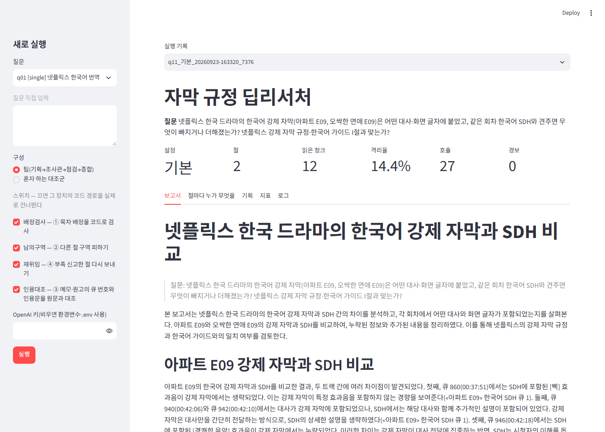
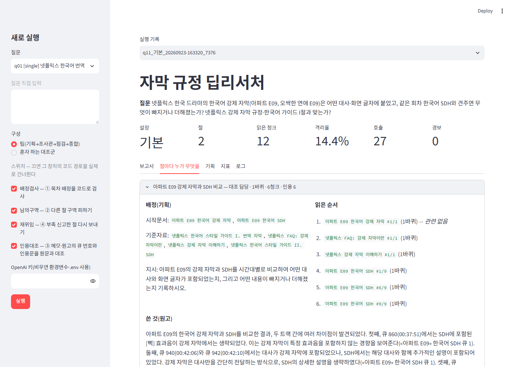

# 자막 규정 딥리서처

넷플릭스·디즈니+·쿠팡플레이 자막 규정과 실제 자막 트랙을 맞대어 보는 오케스트레이터-워커 딥리서치 에이전트. 모두의연구소 9강 프로젝트.

- 코디네이터가 목차를 짜고 절마다 조사관(서브에이전트)을 붙인다
- 조사관은 자기 구역의 청크만 읽고 원고·인용·자기신고만 올린다(원문은 아래에 남는다)
- 부족하다고 신고한 절만 다시 보낸다
- 정답표·판정 모델 없이 코드로 지표를 잰다
- 설계·실험·실패 분석은 [REPORT.md](REPORT.md)
- 자료 출처: 작성자의 자막 도구 [subtitle-tc-generator](https://github.com/tigermorning/subtitle-tc-generator)를 만들며 모은 규정·자막(원문은 로컬 전용). 코드는 그 저장소에 의존하지 않는다

## 구조

```
기획 → 배치 → 조사관 ×N(병렬) → 점검 ─(부족 신고한 절)→ 배치
                                  └─(빈 칸 없음·바퀴 소진·재위임 꺼짐)→ 종합 → 평가
```

| 파일 | 하는 일 |
|---|---|
| `graph.py` | LangGraph 파이프라인(① 기획 ~ ⑥ 평가), CLI |
| `metrics.py` | 지표(경보 4 · 견줌 11). 지표마다 보는 장치를 `SPEC`에 적음 |
| `baseline.py` | 혼자 하는 대조군(같은 자료·모델·도구·읽기 예산) |
| `ablation.py` | 스위치 하나씩 끈 설정 + 대조군을 여러 번 돌려 집계 |
| `app.py` | streamlit 데모 |
| `config.json` | 절 수 · 절 예산 · 기준 예산 · 바퀴 상한 · 청크 크기 · 스위치 · 역할 명단 |
| `data/questions.json` | 질문 12건(단일 2 · 흩어진 6 · 한 대상 4). 질문마다 `why` |
| `data/sources.json` | 코퍼스 목록(본문 없음) |
| `scripts/build_corpus.py` | 로컬 원본 → `data/corpus.json` |
| `scripts/check_plans.py` | ① 기획만 12문항에 돌려 목차 검사 |
| `scripts/capture_demo.py` | README용 데모 화면 캡처 |
| `output/` | `runs.jsonl` · `ablation.json` · `ablation.md` · `reports/` |

## 준비

- Python 3.12, 패키지

```bash
pip install langgraph openai tiktoken streamlit
```

- OpenAI 키: 환경변수 `OPENAI_API_KEY` → 저장소의 `.env` → `~/Documents/openai_key.env` 순으로 찾음
  - `.env`는 gitignore. 키를 저장소에 올리지 않음
  - 데모 화면에서는 옆 칸에 붙여 넣어도 됨(세션 안에서만 씀)
- 코퍼스: 자막·규정 원문은 저작물이라 저장소에 없음. 원본이 있는 PC에서 빌드

```bash
python scripts/build_corpus.py
```

- 끝에 `총 60건 … 링크 없는 문서: 없음`이 나오면 정상
- 60건 · 1,609,245자 · 836,287토큰 = gpt-4o-mini 창(128k)의 6.53배

## 실행

- 한 질문 (Windows 콘솔은 `PYTHONIOENCODING=utf-8` 필요)

```bash
PYTHONIOENCODING=utf-8 python graph.py q03
```

- 스위치 끄기 (`배정검사` · `남의구역` · `재위임`)

```bash
PYTHONIOENCODING=utf-8 python graph.py q03 --off 남의구역
```

- 혼자 하는 대조군

```bash
PYTHONIOENCODING=utf-8 python baseline.py q03 --budget 18
```

- 절제 실험 (기본 5문항 × 5설정 × 3회)

```bash
PYTHONIOENCODING=utf-8 python ablation.py
```

- 지표만 다시 계산(API 호출 없음)

```bash
PYTHONIOENCODING=utf-8 python ablation.py --collect --recompute
```

- 데모

```bash
streamlit run app.py
```

## 데모 화면

- 지난 실행을 고르거나 새로 실행(질문 · 팀/대조군 · 스위치)
- 탭: 보고서 · 절마다 누가 무엇을(배정 → 읽은 순서 → 원고 → 부족 신고) · 기획(코드가 고친 것) · 지표 · 로그
- 캡처: `python scripts/capture_demo.py <실행 이름>` (streamlit을 띄운 상태에서, Playwright 필요)
- `?run=<실행 이름>`으로 특정 실행을 바로 연다





## 저작권·비밀

- 저장소에 올리지 않는 것: `data/corpus.json` · `data/raw/` · `output/runs/`(조사관 메모 = 자막 발췌) · `.env`
- 보고서 속 자막 인용은 짧은 대사 단위
