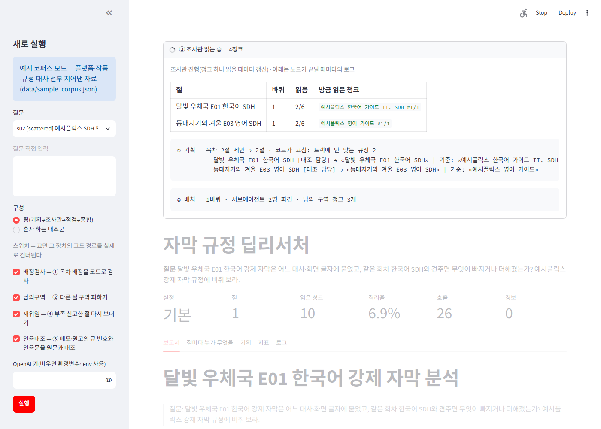
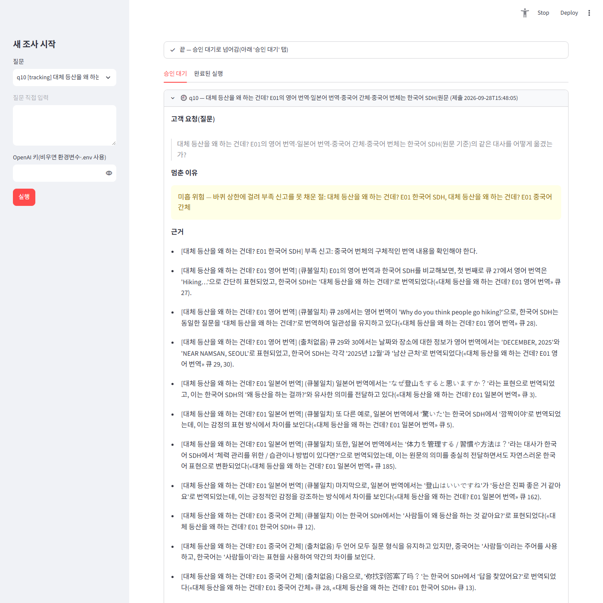
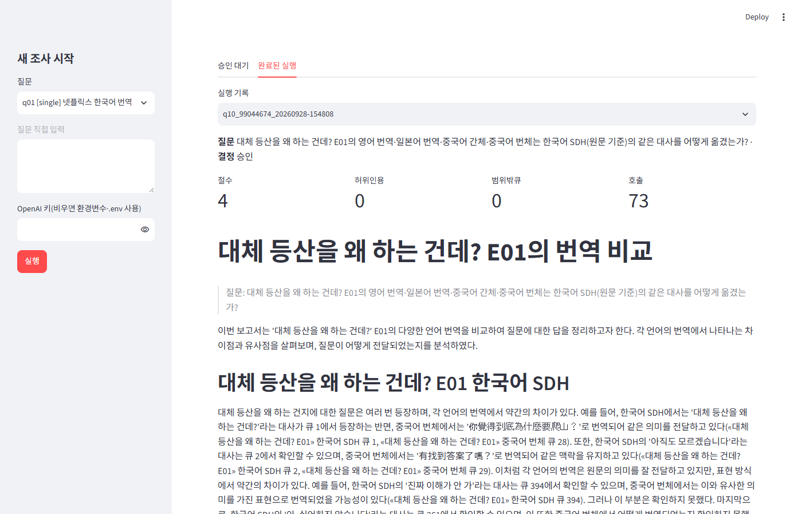

# REPORT — 자막 규정 딥리서처

- 과제: 모두의연구소 9강 프로젝트(오케스트레이터-워커 딥리서치 에이전트)
- 모델: gpt-4o-mini (코디네이터·조사관·대조군 모두)
- 프레임워크: LangGraph

## 1. 주제와 코퍼스

### 주제

- 스트리밍 자막의 **규정(스타일 가이드)과 실제 트랙이 맞는가**
- 이 주제를 고른 이유
  - 답이 문서 한 건에 없다: 규정은 영어 가이드에, 사례는 수만 자짜리 자막 트랙에 흩어져 있다
  - 트랙끼리 **같은 시간대**로 맞대야 보이는 것이 많다(강제 자막 ↔ SDH, 번역 ↔ 원문)
  - 작성자가 자막 도구를 만들며 모은 자료라 사례를 직접 검증할 수 있다

### 코퍼스 (`scripts/build_corpus.py`)

| 항목 | 값 |
|---|---|
| 문서 | 60건 = 규정 34 + 자막 트랙 26 |
| 규정 | 넷플릭스 파트너헬프 26건(한국어·영어 가이드는 절 단위로 나눠 30문서) + 디즈니+·쿠팡 작업자 자료 4건 |
| 트랙 | 넷플릭스 18 · 디즈니+ 7 · 쿠팡플레이 1 / 번역 12 · SDH·CC 10 · 강제 자막 3 · 원어 자막 1 |
| 글자 | 1,609,245자 |
| 토큰 | 836,287 (o200k_base) = gpt-4o-mini 창 128k의 **6.53배** |
| 링크 | 134 (규정 간 참조 + 트랙 → 종류에 맞는 규정 절 + 같은 회차 트랙끼리) |
| 링크 없는 문서 | 0 |

- 읽기 단위 = **청크**(8,000자 이하, 227개)
  - 트랙 하나가 최대 11.5만 자라 문서 단위로 읽으면 한 번에 창의 절반을 쓴다
  - 트랙은 큐 줄 경계, 규정은 `#` 제목 경계에서 자른다
- 뺀 것
  - 공개 규정이 없는 플랫폼(HBO·Viki·VIU)의 트랙 — 대조할 잣대가 없음
  - 강제 자막인지 확정 못 한 트랙, 컨테이너 손상 트랙(중국 드라마 3편)
- 저작권: 자막·규정 원문은 저장소에 없음. 로컬 원본에서 빌드
  - 대신 [data/corpus_index.json](data/corpus_index.json): 60건의 제목·메타·글자 수·토큰 수·청크 수와 links 전체(본문 제외, `scripts/export_index.py`)
  - 위 표의 숫자는 이 색인의 `합계`와 같다

### 질문 12건 (`data/questions.json`)

| 유형 | 문항 | 왜 이 유형인가 |
|---|---|---|
| 단일 | q01 한 줄 글자 수·읽기 속도 · q02 자막·SDH·CC 차이 | **일부러 넣음** — 규정 한 건이면 끝. 이 구조를 쓰면 안 되는 경우 |
| 흩어진 | q03~q06 · q11 · q12 | 플랫폼·작품·트랙이 여러 갈래. 갈래마다 한 명 |
| 한 대상 | q07~q10 | 한 작품·한 회차를 여러 언어 트랙으로 따라감. 원문 트랙은 모두가 기준으로 공유 |

- 정답표는 없다. 질문마다 `why`(나눌 만한가) 한 줄

## 2. 분업 설계

### 목차는 내용 단위로

- 절 = **자료(트랙·구간) 단위**. 작품별·플랫폼별·언어별
- 같은 자료를 역할만 바꿔 나누지 않는다
  - 읽기가 겹치고, "규정과 실제를 맞대기"를 아무도 안 하게 된다(종합은 원문을 못 본다)
  - 실측: q08에서 4절이 같은 트랙을 '규정·관행·대조·예외'로 나눠 가짐 → 코드가 합침(아래 기획 표 4·5회차)
- 형식 단위(개요·분석·결론) 금지는 프롬프트 + 코드 둘 다로 막는다

### 절마다 배정하는 것

| 칸 | 뜻 | 겹침 |
|---|---|---|
| 역할 | 명단 4개(규정·관행·대조·예외 담당) 중 하나 | - |
| 시작문서 | 그 절이 맡아 읽을 트랙(또는 청크 구간) | **금지** |
| 기준자료 | 대조할 규정 + 원문 쪽 트랙 | 허용(공유 잣대) |
| 예산 | 맡은 자료 4청크 + 규정 2청크 | - |
| 지시 | 무엇을 찾을지 한두 문장 | - |

- 역할 명단 (`config.json`)

| 역할 | 하는 일 |
|---|---|
| 규정 담당 | 해당 플랫폼·언어·자막 종류의 규정에서 기준 조항(수치·표기법·예외)을 찾아 조항 번호와 함께 뽑는다 |
| 관행 담당 | 실제 자막 트랙에서 표기 사례를 모으고 어떤 방식이 몇 번 쓰였는지 센다 |
| 대조 담당 | 같은 장면의 트랙 둘 이상을 시간대로 맞대어 무엇이 다르게 옮겨졌는지 적는다 |
| 예외 담당 | 규정과 어긋나거나 규정이 다루지 않는 사례를 찾아 어느 트랙 몇 번 큐인지 적는다 |

  - 역할은 절마다 하나. 역할만 바꿔 같은 자료를 나누는 것은 금지(아래 기획 표 4·5회차)
  - 실측(12문항 팀 74실행 · 185절): 대조 담당 149 · 관행 담당 18+5=23 · 규정 담당 12 · **예외 담당 1**
    - 트랙을 맞대는 질문이 대부분이라 '대조'로 쏠렸다. 규정 담당은 단일 질문(q01·q02)에서만 주로 뽑힘
    - 예외 담당 1회는 q09('규정에 맞는가'를 묻는 질문) — 쓰임새에 맞는 곳에서만 뽑혔다
    - 명단을 줄이지 않은 이유: 185절 중 1절만 바뀌어 효과가 시행마다의 흔들림에 묻히고, config가 바뀌면 기존 104실행과 비교할 수 없다

- 시작문서와 기준자료를 나눈 이유
  - 수업 코퍼스는 모든 문서가 내용이라 "겹침 금지" 하나로 충분했다
  - 여기서 규정·원문 트랙은 모두가 대는 잣대 → 겹침 금지를 적용하면 한 절만 규정을 갖고 나머지는 잣대 없이 출발(실측 q03)

### 배정을 코드가 검사한다 (`check_plan`, 스위치 `배정검사`)

- 모델은 그럴듯한 제목을 지어내고, 칸을 다른 용도로 쓴다. 코드는 **판단하지 않고** 사람이 만든 대응표(링크·필수 규정)만 조회한다
- 검사 순서(순서가 결과를 바꾼 전력이 있음)
  1. «»·따옴표 벗기기 → 없는 제목 제거
  2. 질문이 부르지 않은 트랙 제거
  3. 작품 이름 없는 질문 = 규정 질문 → 1절
  4. 같은 제목·규정만 받은 절 합치기
  5. 기준자료로 떠넘긴 번역 트랙 → 절로 올리기
  6. 시작문서 청크 겹침 제거(전부 겹치면 합침)
  7. 절 수 상한 초과분 → 가장 가벼운 절에 붙임
  8. 트랙 종류별 필수 규정·원문 트랙 채우기

### 기획 노드를 고친 순서 (실패 분석)

| 회차 | 증상 | 원인 | 고친 것 |
|---|---|---|---|
| 1 | q03: 한국어 가이드 II절을 1절이 가져가 나머지는 규정 없이 출발 | 규정까지 '겹침 금지' | 시작문서 / 기준자료 분리 |
| 2 | q01(단일)이 4절로 쪼개지고 SDH 트랙에 번역 절 규정 | 지시 과잉 교정 + 트랙 종류 무시 | 1절 조건 구체화, 기준 규정을 트랙 링크로 검사 |
| 3 | 모델이 제목에 «»를 붙여 전부 무효 | 카드 표기를 그대로 따라 씀 | `_clean`으로 괄호만 벗김 |
| 4 | q08: 같은 트랙을 역할만 바꿔 4절 | 형식 단위 분할의 변형 | 규정만 받은 절 해체, 같은 제목 합치기 |
| 5 | q08: 제목만 바꿔 같은 트랙 재배정 → 빈 절을 무관한 문서로 채움 | 제목 기준 합치기의 빈틈 | 합치기 기준을 **자료 겹침**으로 |
| 6 | q11: 5절 제안 → 1절로 뭉침 | 상한 처리가 겹침 검사보다 먼저 | 순서 교체 |
| 7 | q07: 원문 트랙 누락 | 원문을 담을 칸이 없음 | `기준자료`에 원문 쪽 트랙 허용 |
| 8 | q10: 번역 트랙 4개를 전부 기준자료로 넘기고 1절 | 공유 칸이 떠넘기기 통로 | 기준자료 트랙은 원문 쪽만, 번역은 절로 승격 |
| 9 | q04: 무관한 번역 트랙이 들어와 승격 규칙이 일감으로 만듦 | 질문 범위 검사가 작품 단위 | 트랙 단위 `asked_tracks` |

- 교훈: 모델에게 칸을 하나 열어 주면 그 칸을 다른 용도로 쓴다. 코드 규칙끼리도 부딪힌다 → 규칙을 바꿀 때마다 12문항 전체 재검사(`scripts/check_plans.py`)

### 컨텍스트 격리

- 원문은 `read_one()` 안에서만 쓰이고 밖으로는 메모만 나간다
- 위로 올라가는 것 = 절 원고 + 인용 + 자기신고(충분/부족 + 무엇이 비었나)
- 격리율 = 코디네이터가 본 글자 ÷ 조사관이 본 글자 — 실측은 8절 '격리를 숫자로'

## 3. 조사관 설계와 고친 것

### 한 조사관의 루프 (`researcher`)

1. 첫 시작 청크 읽기
2. **기준 예산**(2청크): 규정 청크만 후보로
3. 맡은 자료 예산(4청크): 모델이 후보에서 고름 — 코드가 후보 안인지 재검증
4. 메모만으로 절 원고 + 자기신고

- 후보(`frontier`)는 코드가 만든다
  - 짝 구간(작은 트랙의 큐 시각이 든 짝 트랙 청크) → 맡은 자료 다음 청크 → 같은 시간대 다른 트랙 → 기준 규정 → 링크 이웃
  - 남의 구역(다른 절 시작문서 + 다른 절이 이미 읽은 청크)은 뺀다(스위치 `남의구역`)
- **맞대기 보기**: 트랙 청크를 읽을 때 같은 회차 짝 트랙의 큐를 **시간이 겹치는 줄 바로 아래** 코드가 붙인다

```
[큐 860 | 00:37:51] - [삑] / - [영어] 해독 시작
    ↔ «아파트 E09 한국어 강제 자막» 큐 2 | 00:37:51: 해독 시작
```

### 조사관을 고친 순서 (실패 분석)

| 회차 | 증상 | 원인 | 고친 것 |
|---|---|---|---|
| 1 | q11: 3청크 중 2청크 '관련 없음', 규정을 한 줄도 안 읽고 '규정과 맞다' | 예산 하나를 트랙이 다 씀 | 기준 예산(규정 전용) 분리 |
| 2 | 규정을 뒤에 읽자 'SDH에 있고 강제 자막에 없는 것'을 전부 위반으로 적음 | 트랙을 읽는 동안 잣대가 없음 | 규정을 앞에(첫 청크 직후) |
| 3 | SDH 청크 메모에 '큐 1 00:06:14 태산' — 실제는 큐 113 | 탭 구분 줄에서 큐 번호를 잘못 읽음 | `[큐 N \| 시각]`으로 또렷이 렌더 |
| 4 | 강제 자막 '태산'이 SDH 큐 113에 있는데 '빠졌다' | 두 트랙을 따로 읽고 기억으로 맞춤 | 맞대기 보기(코드가 시간으로 정렬) |
| 5 | 강제 자막 37분·63분 큐를 SDH 앞 구간만 읽고 '없다' | 후보가 앞에서부터 순서대로 | 짝 구간 후보를 맨 앞에(이유 표시) + '안 읽은 구간은 확인하지 못했다고 적어라' |
| 6 | q10 영어 번역 6청크 전부 '관련 없음'인데 원고 534자(번역문까지 지어냄) | 메모 없이 집필 호출 | 관련 메모 0이면 집필하지 않고 부족 신고 |
| 7 | **규정 청크가 거의 전부 '관련 없음'** — «넷플릭스 강제 자막 이해하기»조차 3회 연속 | '관련 없으면 관련 없음' 지시가 **원문 앞**에 있으면 원문을 읽기 전에 답함 | 지시를 원문 **뒤**로 |
| 8 | 번역 절들이 «»를 안 씀(무근거절 4) | 남의 예시(아파트 E09)만 줌 | 예시에 그 절이 읽은 트랙 제목·큐를 넣음 |
| 9 | '관련 없음.'(마침표)을 관련 있음으로 셈 | 문자열 완전 일치 | `irrelevant()`로 정규화 |

- 7이 가장 컸다: 1~6을 고치는 동안에도 규정 메모가 비어 있었고, 지표(규정대조율)는 '규정 청크를 읽었다'만 봐서 못 잡았다. 사람이 메모를 펼쳐 보고 찾음
  - 실측: 같은 규정·같은 질문, 지시 위치만 다른 세 변형 → 앞: '관련 없음' / 뒤: 조항 추출 / 탈출구 없음: 조항 추출

### 두 번째 판(v2) — 9절 실패를 막는 장치 8가지

- 첫 판(v1, 104실행)을 나란히 읽어 찾은 실패(9절)를 막으려고 조사관 루프에 코드 장치를 더함
- 원칙은 v1과 같다: **판단은 모델, 대조는 코드**. 코드는 원문과 글자·번호만 맞대고, 틀린 곳을 짚어 **한 번만** 되묻는다

| 표시 | 장치 | 어디서 | 막으려는 사례(9절) | 스위치 |
|---|---|---|---|---|
| A | 기준 예산의 후보 = 트랙 종류별 **필수 규정** 중 아직 안 읽은 문서 | 조사관 규정 단계 | q11 «넷플릭스 강제 자막 이해하기»를 안 읽음 | 늘 켬 |
| B | 원고 문장의 '«트랙» 큐 N + 인용문'을 그 큐 본문과 대조(`[ ]`도 인용으로 봄) | 집필 뒤 | q03 '큐 162 [음산한 음악]' | `인용대조` |
| B+ | 큐 번호로 못 가린 따옴표 인용 → 읽은 청크·본 짝 큐 어디엔가 있어야 | 집필 뒤 | q10 번역문 창작 | `인용대조` |
| B++ | '«트랙» 큐 N'의 N이 읽은 범위·본 짝 밖 → 인용문 없어도 잡음(경보 범위밖큐와 같은 기준) | 집필 뒤 | q11 확인 실행에서 범위밖큐 1(아래) | `인용대조` |
| M | 메모의 큐 번호가 이 청크·앞서 읽은 청크 범위 또는 코드가 보여 준 ↔ 짝인지 | 메모 뒤 | q11 강제 자막 '큐 3~7' 짝 창작 | `인용대조` |
| P | 큐 적은 짝 트랙(강제 자막, 60큐 이하)의 ↔ 줄이 메모에 빠지면 그 쌍을 짚어 되묻기 | 메모 뒤 | q11 SDH 큐 113 '태산' 누락 | `인용대조` |
| R | 규정 청크를 읽을 때는 앞 메모 맥락을 주지 않음 | 메모 | q01 '12·9자'를 FAQ 출처로 | 늘 켬 |
| C | **표기 통계**: 트랙 전체의 `[ ]`(화자/효과음)·'음악'·서술형 `[ ]`·소괄호·♪·#·줄 길이·`{\an8}` 개수를 코드가 세어 집필에 줌 | 집필 | q03 등산 SDH 효과음·음악 0건을 놓침, `{\an8}` 오독 | 늘 켬 |
| F | 대조군이 질문이 부른 트랙을 하나도 안 고르면 코드가 앞에 넣음(질문의 회차·트랙 낱말 우선) | 대조군 시작 | q06·q08·q09 대조군 트랙 0청크 | 늘 켬 |

- 되물어도 틀리면: 원고 문장은 지우고, 메모는 틀린 줄만 지운다(틀린 번호가 위로 올라가지 않게)
  - 인용 문장을 3개 이상(또는 30% 이상) 지운 절은 모델의 '충분' 신고를 믿지 않고 재위임
- C는 원문 발췌가 아니라 **개수만** 준다. 조사관 입력으로 세므로 격리율에 포함
- 대조군도 같은 도구(B·B+·M·P·C)를 쓴다 — '같은 도구' 공정성
- 새 스위치 `인용대조`: B·B+·B++·M·P를 한꺼번에 끈다. A·R·C·F는 끄지 않음(스위치를 늘리면 절제 실험 호출이 설정 하나당 20%씩 늘어서)

#### 넣기 전에 LLM 없이 확인한 것

- v1 실행 기록(`output/v1/runs/`)의 원고·메모에 검사 함수만 돌림
- 9절 사례 네 건을 모두 잡음
  - q03 `7184` 큐 162 (B)
  - q10 `6264`·`4168` 번역문 창작 (B+)
  - q11 `4032` SDH `#6/9` 메모의 강제 자막 큐 4~7 (M)
  - q11 `4032` SDH `#1/9` 짝(강제 1 ↔ SDH 113) 누락 (P)
- 오탐 줄이기: v1 원고 약 2,300문장 중 걸린 문장 표본을 두 번 읽고 규칙을 좁힘
  - 한 글자 따옴표("네") 사이를 인용으로 잡음 → 미리 지움
  - 작품 이름을 따옴표로 쓴 것('아파트 E09') → 건너뜀
  - «…II. SDH» 안 마침표·따옴표 안 마침표에서 문장이 잘림 → 자르지 않음
  - `[화자]` 같은 표기 이름 → 인용문으로 안 봄
  - 규정만 인용한 문장의 '큐 N' → 어느 트랙인지 모르니 건너뜀
  - 최종: 2,310문장 중 135문장(큐불일치 77 · 출처없음 45 · 안읽은큐 13). 마지막 표본은 전부 실제 오류
- 예시 코퍼스(지어낸 자료, 심어 둔 어긋남 있음) s02: 팀이 심어 둔 어긋남 셋을 새로 찾음(화자 소괄호 · 효과음 서술형 · 영어 효과음 소괄호). v1은 0건
  - 대신 영어 대문자 화자(규정대로)를 위반이라 함 — 해석 오류는 그대로

## 4. 점검(재위임) 규칙

- LLM 호출 없음. 조사관 자기신고만 모은다
- 종료 조건 둘: 스위치 `재위임` 꺼짐 / 바퀴 상한(2) — 멈춘 이유를 `종료`에 남김
- 재위임 지시에 "지난번에 무엇을 읽었지만 무엇이 비었다"를 실어 겨냥
- 재위임 바퀴는 기준 예산 없음(규정은 1바퀴에 읽음), 지난 메모·읽은 청크에서 이어 읽음
- **두 번째 원고 채택 규칙**: 새 원고의 유효 인용 수가 지난 원고보다 적으면 지난 원고를 지킨다
  - 이유: 새로 읽은 메모까지 다 넣고 다시 썼는데 인용이 줄었다면 글이 나빠진 것
  - 무조건 덮어쓰면 인용 빠진 재작성본이 멀쩡한 원고를 지운다
  - 지킨 절은 `되돌림`에 남기고 로그에 찍는다

## 5. 지표 (`metrics.py`)

- 정답표·판정 모델 없음. 만들어진 글(원고·맺음말)과 실제로 읽은 청크만 본다
- **경보** = 0이어야 정상(하나라도 나오면 그 실행은 명백한 실패) / **견줌** = 설정끼리 비교할 때만 뜻이 있음

| 지표 | 종류 | 보는 장치 | 한 줄 설명 |
|---|---|---|---|
| 허위인용 | 경보 | ③ 조사관 · ⑤ 종합 | «»로 인용했는데 읽지도, 맞대기 보기로 보지도 않은 문서 수 |
| 범위밖큐 | 경보 | ③ 조사관 | '«트랙» 큐 N'의 N이 읽은 청크 범위에도, 본 짝 큐에도 없음 |
| 무근거절 | 경보 | ③ 조사관 | 유효 인용 0개인 절 수 |
| 무효배정 | 경보 | ① 배정검사 | 목차에 남은 없는 제목 수 |
| 격리율 | 견줌 | ②③ 격리 | 코디네이터 입력 글자 ÷ 조사관 입력 글자 |
| 중복률 | 견줌 | ② 남의구역 | 맡은 자료 읽기 중 다른 절도 읽은 청크 비율(기준자료 공유 읽기는 뺌) |
| 규정대조율 | 견줌 | ① 기준자료 · ③ | 트랙을 읽은 절 중 규정 청크도 읽은 절 비율 |
| 트랙도달률 | 견줌 | ① 기획 | 질문이 부른 트랙 중 누군가 읽은 비율 |
| 읽고안쓴문서 | 견줌 | ③ · ④ | 관련 메모가 나왔는데 원고에서 인용 안 한 문서 비율 |
| 인용밀도 | 견줌 | ③ | 원고 1,000자당 유효 인용 수 |
| 인용문일치율 | 견줌 | ③ | 큐 번호 하나 + 따옴표 인용이 있는 문장에서 인용문이 실제 그 큐 본문에 있는 비율 |
| 예산소진율 | 견줌 | 공정성 | 읽은 청크 ÷ 받은 예산 |
| 재위임절 · 재위임새청크 · 되돌림 | 견줌 | ④ 점검 | 루프가 실제로 돌았는지, 돌아서 새로 읽었는지, 재작성본을 버렸는지 |
| 인용고침 (v2) | 견줌 | ③ 인용대조 | 원고에서 코드가 틀린 인용으로 잡아 다시 쓰게(또는 지우게) 한 문장 수. 인용대조를 끄면 0 |
| 메모고침 (v2) | 견줌 | ③ 인용대조 | 메모가 없는 큐·안 본 짝을 적었거나 강제 자막 짝을 빠뜨려 되물은 청크 수 |

- 인용 검사는 문서 이름 그대로(`«히틀러 심판의 날 E01 한국어 번역» 큐 3` — 트랙마다 문서가 따로라 트랙까지가 이름)로 저장 전에 끝난다. 보고서 파일(`output/reports/*.md`)에 쓸 때만 작품 제목에서 트랙 종류를 떼어 `«히틀러 심판의 날 E01» 한국어 번역 큐 3`으로 적는다(`metrics.display_titles`, 사용자 지시 — 데모의 원고 보기도 같음). 글자 수가 같아 지표는 안 바뀜
### '보는 장치'가 실제로 맞는가 — 실측 근거의 세기 (v2)

- 위 표의 '보는 장치'는 설계할 때 적은 것이다. 스위치를 끄거나 대조군과 견줬을 때 그 지표가 **실제로 움직였는지** 5문항 × 3회로 확인했다
- 쓰는 법: 결과가 나쁠 때 어느 장치를 고칠지 고르는 근거. 세기가 '약함'·'없음'인 연결로는 "이 장치가 좋아졌다"고 쓰지 않는다

| 연결 | 실측 (v2) | 세기 |
|---|---|---|
| 격리율 ← 분업 구조 | 팀 3~46% vs 대조군 100%(모든 칸) | **강함** — 구조를 없애면 100% |
| 인용문일치율 ← 인용대조 | q10: 끄면 60~80% vs 켜면 100%(3회 모두). 남은 틀린 인용 16% → 0(8-1) | **강함** — 다만 q10에서만. 다른 문항은 끈 쪽도 대부분 100% |
| 트랙도달률 ← 배정검사 | q10: 끄면 20~80% vs 켜면 100%(3회 모두). 나머지 4문항은 켜든 끄든 같음 | **보통** — 5문항 중 1 |
| 규정대조율 ← 기준자료(기준 예산) | 팀 100% vs 대조군 0%(q07 · q10). 스위치 넷에는 반응 없음 | **보통** — 대조군과만 갈림. 기준 예산을 끄는 스위치가 없어 단독 효과는 못 잼 |
| 무근거절 ← 재위임 | 재위임끔 1/15 · 배정검사끔 1/15 · 기본 0/15 | **약함** — 드물고 재위임만의 신호도 아님 |
| 허위인용 ← 집필 인용 목록 | 기본 1/15, 스위치 하나 끄면 0~2/15. 대조군은 인용 규칙을 팀과 같게 한 뒤에도 18/29실행 — 거의 전부 작품 이름·조항 번호에 «» | **약함** — 스위치보다 '한 번에 쓰는 글의 길이'에 반응(8-1) |
| 인용밀도 ← 집필(③) · 분업 | 인용 규칙을 같게 한 뒤에도 5문항 모두 팀이 높음. 그런데 **절이 하나라 구조가 같은 q01 · q02에서도 팀이 높음** | **약함** — 분업 효과에 원고 형식(절 8~15문장 vs 보고서 25~45문장)이 섞임 |
| 중복률 ← 남의구역 | 켜든 끄든 0%. 배정검사를 끈 q11에서만 19~25% | **없음** — 이 지표는 남의구역이 아니라 배정검사에 반응 |
| 무효배정 ← 배정검사 | 배정검사를 끄고도 0/15 — v2 모델 목차가 없는 제목을 안 냄 | **잴 수 없음** — 배정검사의 값은 트랙도달률 · 호출 수에서 보임 |
| 읽고안쓴문서 ← ③ · ④ | 설정 사이 방향 없음. 같은 칸 안 폭이 최대 35%p | **없음** |

- 버린 지표: '보고서 길이'(한 줄로 좋고 나쁨을 말할 수 없음), '관련 없음 비율'(지시 위치 하나로 뒤집힘 — 3절 조사관 표 7)
- 지표의 한계 (사람이 잡아야 하는 것)
  - 범위밖큐는 **번호가 범위 안이면 통과** — '«SDH» 큐 2'처럼 짝 트랙 번호를 엉뚱한 트랙에 붙여도 범위 안이면 못 잡음(q11 실측)
    - 그래서 **인용문일치율**을 나란히 읽기(8절) 뒤에 추가: 번호는 맞는데 내용이 다른 인용(q03 '큐 162 [음산한 음악]' ↔ 실제 '- 근데 / - [진경] 아!')을 잡음
    - 그래도 해석 오류는 못 잡음 — 인용문은 맞고 해석이 틀린 경우(큐 473 '와, 바람 소리야?'를 효과음이라 부름)
  - 규정대조율은 '규정 청크를 읽었다'만 봄 — 메모가 '관련 없음'이어도 100%(3절 조사관 표 7을 못 잡은 이유)

## 6. 파이프라인 구조도


| State 키 | 리듀서 | 내용 |
|---|---|---|
| `question` | - | 질문 |
| `plan` | 덮어쓰기 | 목차 · 배치(이번 바퀴 절 번호) · 바퀴 · 종료 사유 · 채택(절 번호 → 채택 원고) · 되돌림 · 재위임기록 · 예산기록 · 코드가 고친 것 |
| `sections` | `operator.add` | 조사관 원고(재위임되면 같은 절이 여러 벌 쌓임 → 점검이 바퀴로 거름) |
| `visited` | `operator.add` | (절 번호, 청크, 바퀴) — 누가 언제 무엇을 읽었나 |
| `task` · `prior` | - | `Send`로 조사관 한 명에게만 가는 지시 · 지난 원고 |
| `report` · `metrics` · `log` | 덮어쓰기 / add | 보고서 · 지표 · 노드별 로그 |

## 7. 코드 리뷰로 잡은 버그

### 첫 판(v1) — 절제 실험 전

- 첫 절제 실험을 돌리다 멈추고, 별도 리뷰 에이전트에게 "결과를 조용히 틀리게 만드는 버그"만 찾게 함 → 15건, 결과를 바꾸는 것 10건 고치고 처음부터 다시 돌림

| 버그 | 결과에 미친 영향 | 고친 것 |
|---|---|---|
| API가 계속 실패하면 `{}`를 돌려주고 계속 진행 | 빈 실행이 평균에 섞임(동시 6프로세스라 속도 제한 위험) | 일시적 오류가 다하면 예외, JSON 실패만 `{}` + 카운트 → 집계에서 뺌 |
| 재위임된 절의 피하기 목록에 **자기 시작문서 청크**가 들어감 | 남이 기준자료로 읽은 내 청크를 못 읽음 → 남의구역 비교가 기울어짐 | 피하기 = 남의 것 − 공유 − 내 것 |
| 빈 원고도 `충분=True` | 빈 절이 재위임에서 빠짐 | `충분 = (값이 True) and 원고 있음` |
| 후보를 25개로 자른 **뒤** 규정만 거름 | 트랙 청크가 많은 절(합친 절·대조군)은 기준 예산이 규정을 한 번도 못 봄 | 자르기 전에 거름(`rules_only`) |
| 지난 원고를 지킨 절은 다시 안 보내고 종료 사유도 틀림 | 바퀴 소진인데 '빈 칸 없음' | 빈 칸 = 이번 바퀴에 보낸 절 중 채택본이 부족한 절 |
| 배정검사를 끄면 «» 벗기기도 꺼짐 | 그 조건이 검사가 아니라 표기 잡음을 잼 | 형식 정리는 늘 켬 |
| 짝 트랙(맞대기 보기로 본 것) 인용을 허위로 셈 | 경보가 부풀려짐 | 본 짝 큐를 메모에 기록해 인정 |
| 팀은 절 원고만, 대조군은 보고서 전체 인용을 검사 | 검사 범위가 달라 비교 불공정 | 팀의 머리말·맺음말도 검사 |
| 대조군 보고서를 JSON 안에 받다가 깨짐 | 대조군 빈 보고서 | 대조군만 평문 마크다운 |
| 대조군 예산 = 팀이 **받은** 예산 | 팀이 일찍 멈추면 대조군이 더 읽음 | 팀이 **실제로 읽은** 청크 수의 평균 |

### 두 번째 판(v2) 리뷰 — 재실행 전

- v2 장치(3절)를 넣고 재실행 전에 다시 별도 리뷰 에이전트에게 맡김 → 13건(HIGH 2 · MEDIUM 7 · LOW 4). 전부 고친 뒤 재실행

| 버그 | 그대로 뒀다면 | 고친 것 |
|---|---|---|
| 고친 문장을 목록으로 받음 | 모델이 하나를 빼먹으면 뒤 문장의 수정문이 앞 문장 자리에 들어가고 한 문장이 사라짐 | 번호를 키로 받음. 답이 비면(JSON 실패) 원고를 그대로 둠 |
| 문장 나누기가 소제목·개조식 줄을 다음 문장에 붙임, 짝 없는 `"` 하나면 원고 전체가 한 덩어리 | 한 문장이 걸리면 소제목부터 절 끝까지 삭제 | 줄바꿈에서 늘 자름, `#` 줄 제외, 300자 넘는 덩어리는 손대지 않음 |
| '모두 다 읽었다'의 '다 '에서 자름 | 문장 조각이 모델에게 가고, 돌아온 수정문이 문장 중간에 끼워짐 | 마침표·물음표 뒤에서만 자름 |
| '큐 3~9'를 큐 3으로만 봄 | 맞는 인용이 큐불일치로 지워짐 | 범위·나열 표기면 큐 대조를 건너뜀 |
| 메모 검사가 앞 청크의 큐를 틀렸다고 봄 | 맥락을 준 뜻과 부딪혀 맞는 줄이 지워짐 | 이 절이 앞서 읽은 범위·본 짝 큐는 인정 |
| 줄을 다 지운 메모가 빈 문자열로 남음 | 빈 메모가 '관련 있는' 메모로 세어짐 | 비면 '관련 없음' |
| A가 남의 구역을 무시 | 기본 설정의 중복률이 올라 남의구역 비교가 흐려짐 | 필수 규정 후보도 피하기 목록을 먼저 적용 |
| 인용 문장을 지워도 '충분' 그대로 | 절반이 지워진 절이 재위임에서 빠짐 | 많이 지우면 부족으로 바꿈 |
| 지표 재계산 때 `대조질문`이 0으로 덮임 | `--recompute` 한 번에 값이 사라짐 | 저장값에서 되살림 |
| 스위치 키가 모자란 옛 실행도 집계 통과 | v1 실행이 v2 '기본' 칸에 섞일 수 있음 | 스위치 키 집합이 다르면 집계를 멈춤 |
| 대조군에 질문의 회차가 아닌 트랙이 들어옴(q08에 E01 SDH) | F가 엉뚱한 트랙을 줌 | 질문의 회차·트랙 낱말이 맞는 트랙부터 |
| 지운 인용 문장이 `runs.jsonl`(저장소)에 남음 | 자막 발췌가 공개 저장소에 늘어남 | 올리는 쪽엔 종류만 |
| 겹공백 정리가 목록 들여쓰기를 없앰 | 개조식 원고 모양이 깨짐 | 줄 가운데 공백만 정리 |

- 재실행 뒤 한 번 더 찾은 것 — 결과 표를 대조군과 견주다 발견

| 버그 | 그대로 뒀다면 | 고친 것 |
|---|---|---|
| 대조군 집필 지시의 인용 규칙이 팀과 다른 문자열: 남의 예시(«아파트 E09 한국어 SDH» 큐 212) · '목록 밖 이름**(작품 이름 등)**' 없음 · '인용이 없으면 무근거' 줄 없음 | 팀과 대조군의 인용 차이가 '분업이 없어서'인지 '지시가 달라서'인지 가를 수 없음 | 인용 규칙을 `graph.cite_rules()` 한 함수로 모아 팀·대조군이 **같은 문자열**을 씀. 예시 문장도 양쪽 모두 실제로 읽은 트랙으로 |

- 팀 프롬프트는 한 글자도 안 바뀌었다 — 가짜 LLM으로 고치기 전후 집필 프롬프트를 뽑아 대조. 그래서 팀 실행은 그대로 두고 **대조군 29실행만** 다시 돌림(`ablation.py --baseline-only`, 예산·횟수는 기존 기본 실행에서, 1,154호출 · 약 $1.1)
- 옛 대조군 29실행은 [output/v2-baseline-old/](output/v2-baseline-old/)에 보관. 바뀐 결과는 8-1
- 남긴 것: 인용대조를 켜면 **인용문일치율이 자기 검사를 다시 잰다**(같은 규칙으로 먼저 고치므로 100%에 가까워짐). 그래서 v2 비교에는 '고치기 전 틀림'(`인용고침`)을 함께 본다

## 8. 절제 실험 결과

- 두 판을 돌렸다
  - **v2(현재 코드)**: 3절 'v2' 장치를 넣은 판. 118실행 — 아래 8-1
  - **v1(첫 판)**: 104실행 — 아래 8-2. 기록은 [output/v1/](output/v1/)에 보관
- v2 결과를 먼저 적고, v1 결과는 '고치기 전' 기준으로 남긴다

### 8-1. 두 번째 판(v2) — 118실행

- 설정: 5문항 × 6설정(기본 · 스위치 넷 하나씩 끔 · 대조군) × 3회 = 90 + 나머지 7문항 × (기본 · 대조군) × 2회 = 28
- 호출 4,814회(그중 인용대조 되물음 167), 입력 약 3,460만 자 ≈ 1,800만 토큰, 비용 약 $3.7(gpt-4o-mini 단가로 추정)
- 실패한 실행 0 · 집계에서 뺀 실행 0 · 예산소진율 모든 칸 100%
- 대조군 29실행은 인용 규칙을 팀과 같은 문자열로 고친 뒤 다시 돌린 것(7절 v2 리뷰 끝). 위 호출 수·비용은 첫 돌림 기준, 대조군 재실행은 1,154호출 · 약 $1.1 더
- 전체 표: [output/ablation.md](output/ablation.md). 아래는 평균(최소~최대)

#### 경보 난 실행 — v1 → v2

| 묶음 | v1 | v2 |
|---|---|---|
| 팀, 5문항 × 스위치 설정 넷(기본·배정검사끔·남의구역끔·재위임끔) | 15/60 | **7/60** |
| 팀, 나머지 7문항 기본 | 1/14 | 2/14 |
| 대조군, 5문항 | 8/15 | 8/15 (규칙을 같게 하기 전 11/15) |
| 대조군, 나머지 7문항 | 4/14 | 10/14 (같게 하기 전 8/14) |

- **범위밖큐는 v2에서 0**(v1: q11 기본 3 · q11 배정검사끔 4 · q10 대조군 2) — 인용대조의 '안 읽은 큐' 검사(B++)가 원고를 올리기 전에 고침
- v2 경보는 거의 전부 **허위인용 = 표기 실수**
  - 작품 이름에 «»(«라스트 하우스», «아파트 E09») · 조항 번호를 제목 안에(«…가이드 II.9 Sound Effects»)
  - 읽지 않은 문서를 인용한 것은 없었다(전부 목록에 없는 제목)
  - 대조군이 늘어난 이유: F로 트랙을 읽게 되자 작품 이름을 인용하는 문장이 늘었다
  - 대조군에게 팀과 같은 인용 규칙('목록 밖 이름(작품 이름 등)에는 «»를 쓰지 마라', 제 트랙 예시)을 준 뒤에도 그대로다 — 허위인용 난 실행 18/29 → 18/29, «아파트 E09»도 3회 그대로. 지시 문구가 아니라 **보고서 하나에 작품 여럿을 한꺼번에 쓰는 형식**에서 나온다고 본다(팀 절은 작품 하나씩)
- 무근거절 3건(q10 재위임끔 · q10 대조군 · q11 배정검사끔) — 인용 문장이 지워져 유효 인용 0이 된 절 포함

#### 남은 틀린 인용 — 같은 검사기로 최종 원고를 다시 잼

- 인용대조 검사기(`metrics.quote_issues`)를 v1 원고와 v2 원고에 똑같이 돌려, 틀린 인용이 남은 문장 비율을 셈
- v2 기본은 이 검사기로 고친 뒤라 **0이 되는 게 당연**하다. 뜻이 있는 비교는 v1 기본 ↔ v2 인용대조끔(검사기가 없는 두 판)

| 문항 | v1 기본 | v2 인용대조끔 | v2 기본 |
|---|---|---|---|
| q10 | 24/126 = 19.0% | 20/125 = 16.0% | 0/115 |
| q07 | 6/104 = 5.8% | 2/107 = 1.9% | 0/102 |
| q11 | 3/62 = 4.8% | 0/56 | 0/55 |
| q03 | 3/95 = 3.2% | 1/87 = 1.1% | 0/88 |
| q01 | 0/25 | 0/27 | 0/23 |

- 번역을 맞대는 q10에서 틀린 인용이 가장 많다(v1·끔 모두 약 1/6 문장). 인용대조가 이것을 고치거나 지웠다
- 인용대조가 한 일(v2 전체): 원고 126문장을 잡아 72 고침 · 54 지움, 메모 55청크 번호 되물음, 강제 자막 짝 누락 29청크 되물음
- 이 검사기가 못 보는 오류(해석 · 규정 적용 · 안 본 것)는 그대로 — 9절 나란히 읽기

#### 장치별로 — v2에서 다시 본 것

- **A 핵심 규정 먼저** — 값을 함
  - 강제 자막을 맡은 절이 «넷플릭스 강제 자막 이해하기»를 읽은 비율: v1 **2/27절** → v2 **32/34절**(«FAQ: 강제 자막이란»도 같음)
  - 필수 규정 전체로는 57% → 67%(예산 2청크보다 필수 규정이 많은 절이 있어 100%는 안 됨)
  - 왜 이렇게 크게 바뀌었나(규정 단계 2·3번째 읽기를 셈)
    - v1: 후보 = 규정 청크 전부. 모델이 27절 중 **24절**에서 «한국어 가이드 I절» #1·#2를 연달아 고름 → 기준 예산 2청크가 한 문서에 다 쓰임. q11 질문이 'I절과 맞는가'라고 이름을 대고, 후보 목록에서도 I절 청크가 앞에 옴
    - v2: 후보 = 필수 규정 중 **한 청크도 안 읽은 문서**의 청크뿐. 한 문서를 읽으면 그 문서의 나머지 청크가 후보에서 빠져, 두 번째는 다른 문서로 갈 수밖에 없다. 32절 전부 «FAQ: 강제 자막이란» → «강제 자막 이해하기» 순
  - **대가**: 강제 자막 트랙의 필수 규정은 셋(FAQ · 이해하기 · 가이드 I절)인데 예산은 2 → 이번엔 I절이 밀려남
    - 가이드 I절이 필수인 절에서 I절을 읽은 비율: v1 40/40 → v2 **24/49**
    - 모델은 두 번 다 '짧고 제목이 질문과 맞는' 문서를 먼저 골랐다(v1은 I절, v2는 강제 자막 2건). A는 '한 문서에 몰아 쓰기'는 막았지만 '무엇을 뺄지'는 여전히 모델이 정한다
    - 고칠 곳: 기준 예산을 필수 규정 수만큼 늘리거나(최대 3), 필수 규정에 우선순위를 두기 — 다음 판
- **배정검사** — 여전히 값을 함
  - q10: 끄면 트랙도달률 60%(20~80) · 호출 21 vs 켜면 100% · 70
  - q01: 끄면 호출 35(14~68) vs 14
  - q11: 끄면 경보 2/3, 중복률 22%
- **재위임** — v2에서는 **값이 흐려졌다**
  - v1 q03: 끄면 인용밀도 절반(8.7 → 4.4), 3회 모두 경보
  - v2 q03: 켬 7.1 vs 끔 7.5, 경보 1/3 vs 1/3 — 차이 없음
  - 추정: 표기 통계(C)와 핵심 규정(A)이 첫 바퀴 원고를 채워, 재위임이 메우던 빈 칸이 줄었다. 재위임절도 3 → 2
- **남의구역** — v1과 같이 값을 못 함
  - q03 기본에서 중복률 10%(0~20)가 나왔는데, 세 절이 기준자료 밖 보조 규정(효과음 예시·FAQ)을 **같은 바퀴에 동시에** 읽은 것. 병렬 출발이라 남의구역으로는 못 막고, 공유 잣대라 낭비도 아님
- **인용대조**(새 스위치) — 값을 함, 대신 인용 수가 조금 준다
  - 남은 틀린 인용: 끄면 q10 16% · q07 1.9% · q03 1.1% → 켜면 0
  - 인용밀도는 끈 쪽이 조금 높음(q03 9.5 vs 7.1, q10 6.0 vs 5.4) — 틀린 문장을 지운 만큼
  - 호출 +0~11/실행, 되물음은 전체 호출의 3.5%
- **분업 자체(팀 vs 대조군)** — **v1 결론의 상당 부분은 대조군이 트랙을 안 고른 탓이었다**
  - F(대조군도 질문이 부른 트랙부터) 뒤 대조군 트랙도달률: q03 33 → 100 · q08 0 → 100 · q09 0 → 100 · q11 50 → 92 · q06 0 → 50
  - 결론을 고침: '같은 예산이면 팀이 더 많은 트랙에 닿는다'는 v1의 주된 근거는 **공정하지 않은 비교**에서 나왔다. 대조군을 공정하게 하자 도달 차이는 거의 사라졌다
  - 남은 차이(인용밀도 · 경보)는 아래 '인용 규칙을 같게 하고 다시 잰 것'

#### 인용 규칙을 같게 하고 다시 잰 것 — 팀 vs 대조군

- 대조군 집필 지시의 인용 규칙이 팀과 달랐다(7절). 같은 문자열로 고치고 대조군만 다시 돌림. 팀 실행은 그대로
- 인용밀도(원고 1,000자당 유효 인용), 평균(최소~최대)

| 문항 | 팀 기본 | 대조군 — 규칙 다를 때 | 대조군 — 규칙 같게 |
|---|---|---|---|
| q01 (단일) | 7.0 (5.4~8.6) | 5.3 | 5.4 (5.1~5.8) |
| q03 | 7.1 (5.8~7.8) | 5.2 | 6.0 (3.4~9.3) |
| q07 | 7.1 (6.3~7.5) | 4.0 | 5.0 (4.6~5.5) |
| q10 | 5.4 (4.5~5.9) | 2.2 | 3.7 (2.6~5.3) |
| q11 | 8.9 (8.6~9.1) | 5.3 | 7.3 (6.8~7.9) |

- 대조군 인용밀도가 5문항 모두 올랐다. 팀과의 격차 평균 2.7 → **1.6** — v1·v2 보고서가 적은 '팀이 인용을 더 붙인다'의 약 40%는 지시 문구 차이였다
- 그래도 5문항 모두 팀이 높다. 범위가 안 겹치는 것은 q07 · q11 둘뿐(q01 · q03 · q10은 겹침)
- 나머지 7문항(n=2): 팀이 높음 4(q02 11.4 vs 6.0 · q04 10.0 vs 6.4 · q09 5.6 vs 3.5 · q12 7.7 vs 4.1) · 대조군이 높음 3(q05 5.6 vs 8.2 · q06 5.7 vs 9.4 · q08 5.6 vs 7.7)
- 남은 격차를 분업의 효과로 다 돌릴 수는 없다
  - q01 · q02는 기획이 절을 **하나**로 짜서 팀도 사실상 한 명이 쓴다(호출 14 vs 13). 그런데도 인용밀도는 팀이 높다(7.0 vs 5.4 · 11.4 vs 6.0)
  - 둘에 남은 차이는 원고 형식뿐이다: 팀 절은 8~15문장 · 머리말 없음, 대조군은 보고서 25~45문장 · 머리말·맺음말 포함(인용이 잘 안 붙는 문장)
  - 그래서 인용밀도 격차에는 '분업'과 '원고 형식'이 섞여 있다. 가르려면 대조군도 절 단위로 나눠 쓰게 한 칸이 더 필요하다(분업 없이 형식만 같게)
- 경보는 여전히 크게 갈린다: 팀 기본 3/29 vs 대조군 18/29(거의 전부 작품 이름 «» 표기 실수, 위 '경보 난 실행')

#### 흔들림 — 팀 vs 대조군

- 같은 조건 3회에서 인용밀도가 움직인 폭(최대 − 최소)

| 문항 | 팀 기본 | 대조군 | 폭이 좁은 쪽 |
|---|---|---|---|
| q01 (단일) | 3.2 | 0.6 | 대조군 |
| q03 | 2.0 | 5.9 | 팀 |
| q07 | 1.1 | 0.9 | 비슷 |
| q10 | 1.4 | 2.7 | 팀 |
| q11 | 0.5 | 1.0 | 팀 |

- 흩어진 · 한 대상 질문 넷 중 셋에서 팀이 덜 흔들린다. 단일 q01은 반대
- 다만 3회라 폭 자체가 흔들린다. '분업이 결과를 안정시킨다'는 방향만 보이고 단정할 근거는 모자란다
- 경보는 방향이 분명하다: 경보 난 실행 팀 기본 1/15 vs 대조군 8/15

#### 미리 적은 예측이 맞았나 — 질문 유형별

- 질문마다 적은 `why`(나눌 만한가)는 첫 실험보다 먼저 커밋했다 — `data/questions.json` 커밋 `3d8efbc`(12:52), 첫 실행 13:50. 결과를 보고 고쳐 쓴 예측이 아니다
- 판정 기준: 인용밀도 · 트랙도달률 · 경보 셋 중 둘 이상에서 팀이 앞서면 '팀 우세'

| 유형 | 예측(`why`) | 실측 (v2, 대조군 규칙 같게) | 판정 |
|---|---|---|---|
| 단일 q01 · q02 | 나눌 필요 없음 — 나누면 조율 비용만 는다 | 기획이 스스로 1절로 짬, 호출 14 vs 13, 경보 0 vs 0. 인용밀도만 팀이 높음(원고 형식 차이 — 위) | **맞음** |
| 흩어진 q03 · q04 · q05 · q06 · q11 · q12 | 갈래마다 한 명 — 팀이 낫다 | 팀 우세 3(q04 · q11 · q12) · 비김 2(q03 — 밀도 팀 · 경보 대조군 · 도달 같음 / q05 — 도달 팀 · 밀도 대조군 · 경보 같음) · 대조군 우세 1(q06 — 밀도 · 도달 대조군) | **반쯤 맞음** (6 중 3, 진 것 1) |
| 한 대상 q07~q10 | 트랙이 창을 넘거나 맞대기와 규정 정리를 나눌 수 있다 — 팀이 낫다 | 팀 우세 3(q07 · q09 · q10) · 대조군 우세 1(q08 — 밀도 · 도달 대조군) | **대체로 맞음** (4 중 3) |

- 예측이 틀린 둘(q06 · q08)은 공통점이 있다: **팀 기획이 질문이 부른 트랙을 다 배정하지 못했다**(팀 도달률 42% · 67% vs 대조군 50% · 100%)
  - 분업의 값은 기획이 갈래를 제대로 나눴을 때만 나온다. 나누기가 빗나가면 팀은 한 명보다 못하다
  - 보완할 점으로 11절에 적음
- n=2~3이라 문항 하나의 판정은 뒤집힐 수 있다. 유형 단위로만 읽는다

#### 결론이 바뀐 자리 모음

- 처음 적었다가 더 재서 바뀐 결론을 한곳에 모음. 본문의 옛 결론은 지우지 않고 그 자리에 고친 이유를 적었다

| 처음 결론 | 무엇으로 바뀌었나 | 바꾼 근거 |
|---|---|---|
| 같은 예산이면 팀이 트랙에 더 많이 닿는다 (v1) | 도달 차이는 거의 없다 | 대조군이 트랙을 안 고른 탓이었다 — F 뒤 q03 · q08 · q09 대조군 도달 0~33 → 100 |
| 대조군 예산 = 팀이 받은 예산 (v1 첫 돌림) | 팀이 실제로 읽은 청크 수 | 팀이 일찍 멈추면 대조군이 더 읽었다(7절) |
| 재위임이 인용밀도를 두 배로 올린다 (v1 q03) | v2에서는 차이 없음(7.1 vs 7.5) | 표기 통계(C) · 핵심 규정 먼저(A)가 첫 바퀴를 채웠다고 추정 |
| 팀이 인용을 훨씬 촘촘히 붙인다 (v2 첫 돌림, 격차 평균 2.7) | 격차 1.6, 그중에도 원고 형식 차이가 섞임 | 대조군 인용 규칙이 팀과 달랐다(7절) |
| 대조군 경보는 남의 예시(«아파트 E09») 탓일 것이다 (이번 수정 전 가설) | 아니다 — 규칙을 같게 해도 18/29 | 작품 여럿을 한 보고서에 쓰는 형식 쪽으로 봄 |
| 남의구역이 중복을 막는다 (수업 코퍼스) | 이 코퍼스에선 값 없음, 중복은 배정검사가 막음 | 켜든 끄든 중복률 0%(v1 · v2 모두) |

#### 격리 (v2)

- 코디네이터 입력은 v1과 같이 1.5만~1.7만 자 고정
- q01 격리율 16.7 → 33.6%: v2 q01은 6청크만 읽고 끝나 분모(조사관 글자)가 작아짐(v1 8.7청크, 재위임 0.7절 → v2 0절)
- 표기 통계(C)는 조사관 입력에 포함 — 트랙 절 격리율은 v1과 비슷(q03 4.7 → 5.1%, q10 4.7 → 3.6%)

### 8-2. 첫 판(v1) — 104실행 (고치기 전 기준)

- 설정: 5문항(q01 단일 · q03 · q11 흩어진 · q07 · q10 한 대상) × 5설정(기본 · 스위치 셋 하나씩 끔 · 혼자 하는 대조군) × 3회 = 75실행
- 나머지 7문항은 기본 · 대조군만 2회씩 = 28실행(+ 빈 실행 대체 1) → 아래 '나머지 7문항'
- 호출 2,998회, 조사관 입력 약 2,037만 자(gpt-4o-mini)
- 대조군 예산 = 같은 문항 '기본'이 실제로 읽은 청크 수 평균 → 예산소진율 모든 설정 100%(공정성 확인)
- 전체 표: [output/v1/ablation.md](output/v1/ablation.md). 아래는 평균(최소~최대), n=3

### 한눈에

| 문항 | 설정 | 경보 난 실행 | 트랙도달률 | 인용밀도 | 인용문일치율 | 읽고안쓴문서 | 호출 |
|---|---|---|---|---|---|---|---|
| q03 | 기본 | 0/3 | 100 | 8.7 | 80.6 | 59.9 | 65 |
| q03 | 재위임끔 | **3/3** (허위 9 · 무근거 2) | 100 | **4.4** | 85.7 | 38.1 | 38 |
| q03 | 대조군 | 2/3 | **33.3** | 4.7 | - | 78.6 | 61 |
| q10 | 기본 | 0/3 | 80 | 6.2 | 63.0 | 33.3 | 53 |
| q10 | 배정검사끔 | 1/3 | **20** | 4.1 | 33.3 | 11.1 | **14** |
| q11 | 기본 | 1/3 (범위밖큐 3) | 100 | 8.5 | 94.4 | 14.3 | 32 |
| q11 | 대조군 | 2/3 | **50** | 4.5 | - | 54.2 | 31 |
| q01 | 기본 | 0/3 | - | 7.2 | - | 66.7 | 20 |
| q01 | 배정검사끔 | 0/3 | - | 8.0 | - | 26.9 | 38 (14~**77**) |

### 나머지 7문항 — 기본 vs 대조군 (n=2)

| 문항 | 성격 | 설정 | 경보 난 실행 | 트랙도달률 | 인용밀도 | 읽고안쓴문서 | 호출 |
|---|---|---|---|---|---|---|---|
| q02 | 단일 | 기본 / 대조군 | 0/2 · 0/2 | - | 6.2 / 4.0 | 25.0 / 33.3 | 14 / 13 |
| q04 | 흩어진 | 기본 / 대조군 | 0/2 · 1/2 (허위 4) | 60 / 40 | 9.7 / 4.4 | 16.6 / 68.8 | 43 / 41 |
| q05 | 흩어진 | 기본 / 대조군 | 0/2 · 1/2 (허위 1) | 44.4 / 33.3 | 5.2 / 8.9 | 0 / 50 | 50 / 49 |
| q06 | 흩어진 | 기본 / 대조군 | 0/2 · 0/2 | 50 / **0** | 8.0 / 5.1 | 37.0 / 68.2 | 43 / 41 |
| q08 | 한 대상 | 기본 / 대조군 | 1/2 (허위 1) · 0/2 | 66.7 / **0** | 7.5 / 3.4 | 26.8 / 72.2 | 31 / 29 |
| q09 | 한 대상 | 기본 / 대조군 | 0/2 · 0/2 | 100 / **0** | 6.5 / 6.2 | 33.3 / 65.0 | 40 / 37 |
| q12 | 흩어진 | 기본 / 대조군 | 0/2 · 2/2 (허위 6 · 무근거 1) | 62.5 / 75 | 7.3 / **1.1** | 22.5 / 75.0 | 31 / 29 |

- 대조군 예산 = 같은 문항 기본의 평균 읽기량(6~24청크), 예산소진율 모두 100%
- 5문항에서 본 경향이 그대로 나옴
  - 트랙도달률: 7문항 중 5문항에서 팀이 높음. q06·q08·q09 대조군은 **시작 자료로 규정만 골라 트랙을 한 청크도 안 읽음**(예산 전부를 규정 9~11건에 씀)
  - 읽고안쓴문서: 대조군 50~75% vs 팀 0~37% — 메모를 한 번에 쓰다 버리는 문제가 반복됨
  - 경보 난 실행: 팀 1/14 vs 대조군 4/14
- 예외: q12 대조군은 트랙도달률이 더 높지만(75 vs 62.5) 인용밀도 1.1 · 허위인용 6 — 트랙 이름은 대고 근거는 거의 안 붙인 글
- q02(단일): 14호출 vs 13호출, 1절 — q01처럼 나눌 이유 없음(질문의 `why`와 일치)
- n=2라 폭은 믿지 말 것(q09 기본 인용문일치율 0~100). 방향이 두 번 모두 같은 것만 위에 적음
- 빈 실행 1건: q05 대조군 1회가 1호출 · 0청크로 끝남 — 모델이 고른 시작 자료 제목이 전부 목록에 없어 버려졌고, 읽을 것 없이 빈 보고서를 씀
  - 고침: `baseline.pick_start`가 한 번 되묻고, 그래도 없으면 실행을 실패로 멈춤. `aggregate`는 읽은 청크 0인 실행을 평균에서 뺌(`_제외`에 남김) → 같은 예산으로 1회 다시 돌려 대체

### 장치별로 무엇이 값을 했나

- **배정검사** — 값을 함. 가장 크게
  - q10: 끄면 모델 목차가 1절(트랙 하나)로 뭉침 → 6청크만 읽고 트랙도달률 20%, 보고서 1/3 길이. 켜면 번역 트랙을 절로 올려 4절
  - q01(단일): 끄면 한 문서 질문을 여러 절로 쪼갬 → 최대 36청크·77호출, 중복률 최대 69%
  - 중복을 막은 것은 남의구역이 아니라 이 검사(시작문서 겹침 제거)
- **재위임** — q03에서만 값을 함
  - q03은 3회 모두 세 절이 전부 부족 신고 → 켜면 2바퀴에 4청크씩 더 읽고 다시 씀. 끄면 인용밀도 절반, 3회 모두 경보
  - q07·q10·q11은 재위임이 0~1절 — 첫 바퀴에 이미 맡은 트랙의 짝 구간을 봄(짝 구간 후보 덕). 비용만 조금
  - 채택 규칙이 실제로 작동: q03 기본 3회 모두 '지난 원고 지킴' 1건 — 재작성본이 인용을 잃은 절
- **남의구역** — 이 코퍼스에선 값을 못 함
  - 중복률 0%가 켜든 끄든 같음(배정검사를 끈 경우만 중복 발생)
  - 이유: 시작문서가 이미 겹치지 않고, 절마다 맡은 트랙이 예산(4청크)보다 길어(5~15청크) 남의 구역까지 갈 일이 없음
  - 수업 코퍼스(문서 34건, 링크로 퍼져 나감)와 다른 점. 트랙 하나가 긴 코퍼스에선 '구역'이 배정 단계에서 이미 정해진다
- **분업 자체(팀 vs 대조군)** — 흩어진 질문에서 값을 함
  - 같은 예산인데 대조군은 트랙도달률 33%(q03) · 50%(q11): 예산 절반을 규정 읽기에 씀(q11 대조군 3회 모두 규정 8청크 이상), 작품 하나만 다루고 나머지는 '확인하지 못했다'
  - 대조군은 관련 메모가 나온 문서의 54~79%(q03·q07·q11)를 보고서에서 한 번도 인용 안 함 — 메모 15~30개를 한 번에 쓰다 버림(q10만 37%)
  - 한 대상 질문(q07·q10)은 차이가 작음: 대조군도 원문 트랙 + 번역 트랙을 짝 구간으로 따라감(q07 트랙도달률 91.7로 오히려 높음)
  - 단일 질문 q01: 팀 20호출 vs 대조군 19호출, 보고서 비슷 → 나눌 이유 없음(질문의 `why`와 일치)

### 격리를 숫자로

- 코디네이터(기획·종합) 입력 글자와 조사관(읽기·고르기·집필) 입력 글자를 `ask()`가 따로 센다. 3회 평균

| 문항 | 기본 | 배정검사끔 | 남의구역끔 | 재위임끔 | 대조군 |
|---|---|---|---|---|---|
| q01 | 16.7% (1.5만 / 10.2만) | 15.6% (1.5만 / 20.3만) | 11.9% | 26.7% (1.5만 / 5.5만) | 100% |
| q03 | 4.7% (1.7만 / 36.1만) | 4.9% | 4.7% | 8.8% (1.7만 / 18.9만) | 100% |
| q07 | 4.5% (1.7만 / 39.4만) | 5.0% | 5.0% | 5.1% | 100% |
| q10 | 4.7% (1.7만 / 37.1만) | 23.5% (1.5만 / 6.3만) | 3.5% (1.7만 / 49.4만) | 4.9% | 100% |
| q11 | 10.1% (1.6만 / 16.3만) | 7.8% | 11.3% | 12.8% | 100% |

- 괄호 = 코디네이터 글자 / 조사관 글자
- 읽는 법
  - **코디네이터 입력은 어느 설정이든 1.5만~1.7만 자로 거의 고정**이다 — 카드 목록(약 1.3만 자) + 절 원고. 원문은 한 글자도 안 올라간다
  - 조사관 쪽은 절 수·바퀴에 따라 5만~49만 자. q10 기본 37.1만 자 ≈ 19만 토큰 — 팀 전체로는 창(12.8만 토큰)을 넘게 읽었는데 코디네이터는 그 5%만 봤다
  - 그래서 격리율이 높은 것은 격리가 깨져서가 아니라 **아래(분모)가 작아서**다: q01(1절)·재위임끔(덜 읽음)·q10 배정검사끔(6청크만 읽음)
  - 대조군은 위아래가 없으니 100%로 둔다 — 보고서를 쓰는 한 명이 읽은 것을 전부 봤다

### 흔들림

- 같은 설정·같은 문항에서도 크게 움직임: q10 기본 인용문일치율 25.0~88.9, q01 격리율 11.6~26.8
- 경보도 시행마다 다름: q11 기본은 3회 중 1회만 범위밖큐 3
- 그래서 차이가 3회 모두 같은 방향이고 폭이 흔들림보다 큰 것만 위에 적음(q03 재위임, q10 배정검사, q03·q11 트랙도달률)

### 과제가 경고한 흔한 사고 셋 — 어떻게 막았나

| 사고 | 이 프로젝트에서 막은 방법 |
|---|---|
| 지표가 좋아진 줄 알았는데 문장 분리 규칙이 바뀐 것 | 지표 코드를 바꾸면 **실험 실행 전부(v1 104 · v2 118)를 같은 코드로 다시 계산**한다(`ablation.py --collect --recompute`, API 호출 없음 — 저장소의 `runs.jsonl`도 함께 다시 씀). 인용문일치율의 따옴표 규칙을 두 번 고쳤을 때 모든 설정의 값이 함께 바뀌었다(q07 35→80→83%) — 설정 간 차이가 아니라 측정기가 바뀐 것이라 전 실행을 다시 셌다 |
| 스위치를 껐다고 로그만 찍고 실제 코드 경로는 그대로 | 스위치마다 꺼지면 건너뛰는 코드 경로가 다르다(배정검사 → `check_plan` 안 부름 / 남의구역 → 피하기 목록 비움 / 재위임 → 빈 칸 목록 비움). 없는 스위치 이름은 실행을 멈춘다(`apply_off`). 집계 때 각 실행의 저장된 config가 **정확히 그 조합**(끈 것만 False, 나머지 True)인지 assert한다. 리뷰 에이전트에게도 "로그만 바뀌는 스위치"를 따로 확인시켰다 |
| 한 번 돌린 결과로 단정 | 설정마다 3회. 표에 평균과 최소~최대를 같이 적고, 3회 모두 같은 방향이면서 폭이 흔들림보다 큰 차이만 결론으로 썼다. 흔들림 자체도 적었다(q10 인용문일치율 25~89%) |

## 9. 나란히 읽기와 실패 추적

### q11 — 기본 vs 대조군 (강제 자막 ↔ SDH)

- 읽은 것: `q11_기본_…_0172` / `q11_대조군_…_2128` 보고서 전문
- **기본이 낫다**, 이유
  - 두 작품을 다 다룸. 대조군은 아파트만 다루고 오싹한 연애는 '확인하지 못했다'
  - 인용 위치가 맞음: 기본이 든 큐를 원문과 대조 — 아파트 SDH 큐 860 '[삑] / [영어] 해독 시작', 862, 873, 878, 오싹한 연애 큐 327·426 모두 본문 일치
  - 대조군은 '«아파트 E09 한국어 SDH» 큐 1, 2'에 '태산'·'해독 시작'을 붙임 — 실제로는 강제 자막의 번호. SDH 큐 1은 '[주제곡]', 태산은 SDH 큐 113. 범위밖큐는 번호가 읽은 범위 안이라 못 잡음
- 대조군이 나은 대목: 아파트 해석은 대조군이 맞음('강제 자막 3개는 SDH에도 있고, SDH는 [삑]·[영어]를 더했다 → 규정 부합')
- **기본의 마음에 안 드는 대목**: "SDH의 '아, 무슨 첩보 영화 찍냐?'가 강제 자막에서 생략 → 규정 I절과 일치하지 않는다"
  - 강제 자막은 원래 일반 대사를 싣지 않는다 — 생략이 정상. 틀린 결론
  - 추적
    - 맺음말 ← 절 '아파트 E09 강제 자막과 SDH 비교'의 원고를 그대로 옮김(종합이 만든 오류 아님)
    - 절 원고 ← 메모 `아파트 E09 한국어 SDH #6/9`: "SDH에는 이 대사가 포함되어 있으나, 강제 자막에서는 생략됨"(사실만 적음, 판단 없음)
    - 규정 메모 `한국어 가이드 I #1/2`: I.8 원문을 정확히 옮김
    - → 오류는 **집필 단계**: 조사관이 사실 메모 + I.8을 이어 붙이며 '생략 = 위반'으로 해석
  - 더 근본 원인: 이 절은 기준 예산 2청크를 한국어 가이드 I 두 청크에 씀. 핵심 규정 «넷플릭스 강제 자막 이해하기»("모든 강제 자막 이벤트는 전체 자막·SDH 파일에도 들어가야 한다")를 안 읽음
- **둘 다 놓친 것**: 강제 자막 큐 3 '자막: 정옥림'(01:03:14)은 SDH에 짝 큐가 없음(±4초 안에 큐 0개, 직접 확인) — 위 규정대로면 실제 누락. 기본은 그 구간 청크(`SDH #9/9`)를 짝 구간 후보로 읽고도 메모에 적지 않음

### q03 — 기본 vs 재위임끔 (SDH 표기 규정)

- 읽은 것: `q03_기본_…_7184` / `q03_재위임끔_…_3772` 절 원고 셋씩
- **기본이 낫다**, 이유: 절마다 10청크(재위임 2바퀴) vs 6청크, 인용 7~13 vs 4~6, 재위임끔의 도라이버 절은 없는 규정 제목 3개를 인용(허위인용)
- 그러나 둘 다 **같은 큐를 반대로 판정**: 대체 등산 SDH 큐 473
  - 기본: "효과음이 대괄호 없이 표기" / 재위임끔: "효과음이 적절히 표기"
  - 원문: '와, 바람 소리야? 와, 진짜' — 효과음이 아니라 **대사**. 둘 다 틀림
- 달라달라 큐 14 '- [익살스러운 효과음] / - [제작진들의 웃음]'
  - 기본: "하이픈 없이 나열 → 위반" / 재위임끔: "대괄호 없이 표기" — 원문엔 하이픈도 대괄호도 있음. 둘 다 틀림
- 기본 도라이버 절 "큐 162 [음산한 음악]" — 실제 큐 162는 '- 근데 / - [진경] 아!' → 번호 틀림(인용문일치율이 잡는 유형)
- 추적: 세 건 모두 **메모는 원문을 그대로 옮겼다** → **집필 단계** 오류
  - 도라이버 메모 `SDH #2/8`: '큐 162 - 근데 / - [진경] 아!', 바로 다음 줄 '큐 163 [음산한 음악]' → 원고가 이웃 두 줄을 합쳐 '큐 162 [음산한 음악]'
  - 큐 473·큐 14도 메모엔 원문 그대로('와, 바람 소리야?' / '- [익살스러운 효과음] / - [제작진들의 웃음]') → 원고가 형식을 잘못 서술
  - 원인 추정: 집필 호출이 메모 8~10개(수십 줄)를 한 번에 받아 '표기 형식'이라는 세부를 옮기며 뭉갬. 맞대기 보기처럼 코드가 도와주는 장치가 집필 단계엔 없음
- 결론: 재위임은 '더 많이, 더 근거 있게'는 만들지만 **해석 정확도**는 바꾸지 못함. 지표가 좋아진 폭(인용밀도 2배)만큼 글이 맞아진 것은 아님

### 눈가림 나란히 읽기 — 네 쌍 더 (2026-09-23)

위 두 쌍은 설정 이름을 알고 읽었다. 판단이 회차·읽는 사람의 기대에 기댄 것인지 확인하려고, 네 쌍을 이름을 가린 채 더 읽었다.

- 고르는 규칙(체리피킹 방지): 문항마다 **앞에서 안 읽은 실행 중 가장 이른 회차**
- 가리기: 보고서 두 편을 A/B로 바꾸고 순서를 섞음(고정 시드). 설정을 드러내는 부록(읽은 청크 목록)은 잘라 냄
- 판정: 쌍마다 별도 LLM 판정자(Claude). 도구는 원문 조회(큐 번호·시간 구간·글자 찾기·규정 전문)뿐, 실행 기록·이 보고서는 못 봄
  - 순서: 원문 보기 전 첫인상 → 인용마다 원문 대조(✓/✗/△) → 판정 → 가장 마음에 안 드는 대목 → 둘 다 놓친 것
- 가리개를 푼 뒤: 판정자 주장 중 결론을 좌우하는 것은 직접 원문으로 다시 확인하고, 틀린 대목은 원고 → 메모 → 원문으로 추적
- 한계: 대조군 보고서는 형식(머리말 소제목)이 달라 짐작할 여지가 있음. 판정자도 LLM이라 원문 대조로 확인한 주장만 적음

| 문항 | 쌍 | 눈가림 판정 | 가리개를 풀면 | 설계 예측과 |
|---|---|---|---|---|
| q01 단일 | 기본 `2552` · 대조군 `2136` | B 근소 우세, 핵심 숫자는 같음(사실상 동등) | B = 대조군 | **맞음** — 단일 질문은 나눠도 이득이 없다 |
| q11 흩어진 | 기본 `4032` · 대조군 `8220` | B 우세 — 두 작품 다 다룸. A는 오싹한 연애를 비움 | B = 기본 | **맞음** — 앞 회차(`0172` vs `2128`)와 같은 판단, 같은 이유 |
| q03 흩어진 | 기본 `9904` · 재위임끔 `7076` | A 근소 우세, 둘 다 오류 많음 | A = 기본 | **맞음** — 앞 회차와 같은 방향. 차이는 앞 회차보다 작음 |
| q10 한 대상 | 기본 `6264` · 배정검사끔 `4168` | A 우세, 둘 다 불합격 수준 | A = 기본 | **맞음** — 배정검사끔은 절 1개·트랙 1개만 읽음(트랙도달률 20%) |

- 네 쌍 모두 방향이 설계 예측과 같다: 단일 = 비슷, 흩어진·한 대상 = 팀(장치 켠 쪽) 우세
- 그러나 '낫다'는 **'덜 틀렸다'**다. 이긴 쪽의 우위는 전부 **도달**(무엇을 읽었나 — 작품 둘 다, 트랙 넷 중 셋)에서 나왔고, 읽은 것을 **해석하는 정확도**는 두 쪽 다 낮았다
  - q03 기본: 원문 대조한 판정 16건 중 ✓ 3건(△ 2). q10 기본: 인용 10건 중 ✓ 1건(△ 4)
- 앞 두 쌍의 판단(기본이 낫다)은 회차를 바꾸고 이름을 가려도 유지됐다 — 체리피킹 의심은 풀림

#### 새로 찾은 실패 — 어느 단계에서 틀렸나

| # | 사례 | 틀린 단계 | 추적 | 지표가 놓친 이유 |
|---|---|---|---|---|
| 1 | q10 두 설정 모두: 제목 대사 '대체 등산을 왜 하는 건데?'의 영어·일본어·간체 번역을 따옴표로 '인용' | **집필(창작)** | 세 문장은 어느 트랙에도 없음(번체 한 줄만 실제). 메모 0건, 한국어 SDH 절 원고에서 처음 나옴. 한국어 SDH엔 이 대사 큐가 없음(화면 글자로 보임) → 빈자리를 모델이 채움 | 큐 번호 없이 따옴표만 → 인용문일치율(큐 번호가 있어야 검사)·범위밖큐 둘 다 대상 밖 |
| 2 | q11 기본: '첩보 영화 찍냐'를 강제 자막 큐 3이라고 씀 | **메모(창작)** | SDH `#6/9` 메모가 '↔ 강제 자막 큐 3·4·5·6·7' 짝 줄을 지어냄. 강제 자막은 3큐뿐, 코드가 붙인 짝은 큐 2 하나. 코드가 붙이는 ↔ 줄 모양을 모델이 흉내 내 늘림 | 메모는 지표 대상이 아님. 원고의 큐 3은 읽은 트랙 범위 안 |
| 3 | q11 기본: "SDH에는 '태산'이 없다" | **메모(누락) → 집필(단정)** | SDH `#1/9`(큐 1~166)를 읽었고 코드가 '강제 큐 1 ↔ SDH 큐 113 태산' 짝까지 붙여 보여 줬는데, 메모 8줄에 113이 없음 → 원고가 '확인 못 함'이 아니라 '없다'로 씀 | '안 쓴 것'은 글에 흔적이 없음(정옥림 사례와 같은 계열, 이번엔 짝 줄이 눈앞에 있었음) |
| 4 | q01 대조군: '초당 12자·9자'를 «FAQ: 대사·강제 자막 읽기 속도» 출처로 인용 | **메모(오염)** | FAQ 청크 메모 앞머리가 앞 청크 메모(I.2 · I.15)를 이 청크 내용처럼 되풀이. `read_one`이 앞 메모를 맥락으로 줌(트랙 맞대기용 장치). 기본 쪽 메모도 같은 모양 | 문서는 실제로 읽었음 → 허위인용 아님 |
| 5 | q01 둘 다: FAQ의 '한국어 23자(일반) · 16자(넷플릭스 오리지널)' 구분을 뺌 | **집필(버림)** | 메모에는 23자가 있었음(기본 `2552` 7번 항목, 대조군 3번 항목). 두 원고 모두 16자만 씀 | '읽고안쓴문서'는 문서 단위라 문서 안의 버린 사실은 못 봄 |
| 6 | q03 둘 다: 대사를 효과음으로(큐 144 · 473), `{\an8}`(위치 태그)를 내용으로, 가이드 예시 형식(곡명 따옴표, 큐 929)을 위반으로 | 집필(해석) | 앞 회차와 같은 유형이 회차를 바꿔도 반복 | 인용문은 실제 본문에 있음 |
| 7 | q03 둘 다 놓침: 대체 등산 SDH에는 **효과음·음악 표기가 0건**(대괄호 311건 = 트랙 첫 줄 1 + 전부 화자 이름) | 기획·조사관(보는 방식) | 청크 몇 개에서 사례를 뽑는 방식으로는 '전체에 없다'를 알 수 없음. 가장 큰 사실을 둘 다 못 봄 | 지표는 '쓴 것'만 봄 |

- 1·2는 **모델이 원문에 없는 문장을 만든 것**(창작)이고, 3·5는 **원문에 있는 것을 버린 것**, 4는 **맥락 장치의 부작용**이다. 이번 네 쌍에서 처음 드러난 유형
- 메모 단계 오류(2·3·4)가 나왔다 — 앞 두 쌍에서는 '메모는 원문을 그대로 옮겼고 집필이 틀렸다'였는데, 메모도 틀릴 수 있다
- 다음 개선에 주는 것(9절 → HANDOFF 9절 A·B·F에 반영)
  - B 넓히기: 인용문 대조를 **큐 번호 없는 따옴표 인용**(1)과 **메모의 '«트랙» 큐 N'**(2)에도. 인용문이 읽은 청크·짝 어디에도 없으면 되돌림
  - 짝 줄이 붙은 큐는 메모에 남기게 코드가 확인(3)
  - 규정 청크를 읽을 때는 앞 메모 맥락을 빼기(4) — 맥락은 트랙 맞대기에만 필요
  - 7은 안 뽑은 C(표기 통계 도구: 트랙 전체의 대괄호·♪·하이픈을 코드가 셈)를 다시 볼 근거

### v2 눈가림 나란히 읽기 — 세 쌍 (고치기 전 → 뒤)

- 방식은 위와 같음: 쌍마다 별도 판정자(Claude) · 원문 조회 도구만 · 부록 잘라 A/B 섞기(고정 시드) · 가리개 푼 뒤 결론을 좌우하는 주장은 직접 확인
- 고른 실행: 칸마다 **앞에서 안 읽은 실행 중 가장 이른 회차**
- 무엇을 보려고: q10 = 인용대조 스위치의 값 / q11 = A·M·P(강제 자막) / q03 = C(표기 통계)·B

| 문항 | 쌍 | 눈가림 판정 | 가리개를 풀면 | 원문 대조 ✓/△/✗ (판정자 표본) |
|---|---|---|---|---|
| q10 한 대상 | v2 기본 `7292` · v2 인용대조끔 `6840` | A 조금 우세, 둘 다 결함 큼 | A = **인용대조 켬** | 켬 4/6/3 · 끔 2/3/7 |
| q11 흩어진 | v1 기본 `5016` · v2 기본 `7376` | A 근소 우세, 둘 다 핵심 놓침 | A = **v2** | v2 4/1/4 · v1 2/2/7 |
| q03 흩어진 | v1 기본 `7164` · v2 기본 `9068` | B 조금 우세(차이 작음) | B = **v2** | v2 3/7/2 · v1 2/5/4 |

- 세 쌍 모두 고친 쪽(v2 · 인용대조 켬)이 이겼다. 모두 **근소**하고, 이긴 쪽도 '덜 틀린' 수준
- 이긴 이유가 장치의 목적과 맞다
  - q10: 진 쪽(끔)의 맺음말이 일본어·간체 번역문을 **지어냄**(`なぜ登山をするのか?` · `为什么要爬山?` — 원문엔 `なんで山に登るの？` · `我们为什么要去远足？`). v1 실패 1과 같은 유형이 인용대조를 끄자 다시 나옴
  - q11: 진 쪽(v1)이 아파트 강제 자막에 **없는 큐 4~8**을 만들어 SDH 대사 7개를 '강제 자막에만 있다'로 뒤집고, 그 위에 'I.20 위반' 결론. v1 실패 2(메모 짝 창작)의 다른 회차. v2는 이 유형이 없음
  - q03: v2가 트랙 전체 개수(하이픈 줄 124 · `{\an8}` 558 · 달라달라 '음악' 36 · **등산 '음악' 0**)를 맞게 댐 — 표기 통계(C). v1은 있는 괄호·하이픈을 '없다'고 씀
- 그대로인 것 — 해석·적용 오류는 두 판 모두 많다(✓보다 △·✗가 많음)

#### v2에서 새로 보인 실패

| # | 사례 | 틀린 단계 | 왜 v2 장치가 못 막았나 |
|---|---|---|---|
| 1 | q10 두 설정 모두: 번역 트랙과 한국어 SDH를 **같은 큐 번호**로 짝지음(SDH 624큐 vs 번역 1,650큐 — 번호가 안 맞음) → '왜곡·축약' 판정 대부분이 옆 장면끼리 비교 | 집필(짝 맞춤) | B는 '«번체» 큐 1545' 인용문이 번체 큐 1545에 있는지만 봄. 인용문은 맞고, 짝지은 SDH 문장이 다른 시각인 것은 검사 밖 |
| 2 | q10 켬: '간체 큐 28 = SDH «그 답을 찾았나요?»' — SDH 쪽 문장은 원문에 없음 | 집필(창작) | B는 한 문장의 인용문 중 **하나라도** 큐 본문에 있으면 통과. 짝 쪽 인용문은 따로 안 봄 |
| 3 | q03 v2: 통계의 '[ ]만 있는 줄 25'를 '효과음 25'로 단정(실제 전부 화자 이름 줄) · '하이픈 줄 124'를 '위반 124'로 | 집필(통계 오독) | C는 개수만 준다. 개수의 **뜻**(두 화자 하이픈은 II.5의 기본 형식)은 여전히 모델이 해석 |
| 4 | q11 v2: SDH 큐 940~982를 '강제 자막에 포함'이라 씀(강제 자막엔 그 시각 큐 없음) | 집필(해석) | 번호는 SDH 읽은 범위 안, 인용문 없음 → B·B++ 대상 밖 |
| 5 | q11 둘 다 놓침: 오싹한 연애 강제 자막 46큐 중 약 38큐가 **영어 대사 번역**(강제 자막의 본래 쓰임) · 아파트 '자막: 정옥림' SDH 누락 | 조사관(보는 방식) | P는 짝 줄이 메모에 **적혔는지**만 봄. 무엇이 중요한 패턴인지는 못 짚음 — v1 실패 7(전체 패턴)과 같은 계열 |

- 1·2는 B를 넓힐 곳을 알려 준다: 한 문장에 인용문이 여럿이면 **각각** 제 트랙 큐(또는 같은 시각 짝 큐)와 맞는지 볼 것
- 3은 도구가 준 숫자도 틀리게 읽힌다는 것 — 숫자에 **뜻을 붙이지 않고** 주는 설계(개수만)의 한계
- 5는 v1에서 두 번째로 반복: 코드가 '빠짐없이 적었나'는 강제할 수 있어도 '무엇이 요점인가'는 못 강제한다

#### 사용자 검토로 잡은 실패 — q12 · q04 (v2)

- 사용자(자막 작업자)가 q12 대조군 `4632` 보고서를 읽고 두 문장을 짚음 → 같은 유형을 v2 실행 기록 전체에서 찾고 원문과 대조
- 대조군 `4632`는 인용 규칙을 팀과 같게 하기 전 실행이다(7절) — 보고서는 [output/v2-baseline-old/reports/](output/v2-baseline-old/reports/)에 있음

| # | 사례 | 틀린 단계 | 추적 | 지표가 놓친 이유 |
|---|---|---|---|---|
| 1 | '말줄임표가 사용되지 않았으며, 이는 작업자 자료의 규정에 어긋난다' — q12 대조군 `4632` · q12 기본 `5576` · `4960` · q04 기본 `7104` | **집필(규정 적용)** | 규정은 '흐릴 때 · 끊길 때' 쓰는 **조건부 허용**이고, 같은 문서에 '기호를 최대한 보수적으로 사용'이라고 적혀 있음. 없으면 쓸 일이 없었다는 뜻이지 위반이 아님(다큐는 말줄임표가 거의 없는 게 정상). 네 원고 모두 메모에는 이 주장이 없고 집필에서 생김. `4960`(블레인 번역 `...` 3개) · `7104`(메이드 인 코리아 SDH `…` 26개)는 '없다'는 사실도 틀림 — 표기 통계(C)에 말줄임표 항목이 없어 모델이 근거 없이 씀. v1 원고에는 이 유형이 없음 | 규정 인용이 실제로 읽은 문서 → 허위인용 아님 |
| 2 | '영어 SDH의 "♪ Yeah, yeah, yeah, yeah ♪"는 "가자!"로 번역되었다'(영어 SDH 큐 558 · 번역 큐 501) — q12 대조군 `4632` | **집필(짝 맞춤)** | SDH 558은 32:50.4~52.7, 번역 501 '가자!'는 32:58.0~59.4. 번역에는 32:47~32:58 사이 큐가 없음 — 노래 가사(SDH 558~560)는 **번역하지 않았고**, '가자!'는 가사가 끝난 뒤의 별개 외침 | 두 큐 번호와 인용문은 각각 원문과 맞음 → B는 통과. 두 큐가 같은 시각인지는 검사 밖(v2 실패 1과 같은 계열) |
| 3 | 위 문장에 이어 '음표 앞뒤로 띄어쓰기를 적용해야 한다는 규칙과는 어긋난다'(«작업자 자료: 작업 기본 원칙») | **집필(규정 범위·적용)** | 인용한 규칙(작업자 자료 '노래의 경우 음표를 붙이는데, 음표 앞뒤로 띄어쓰기 1칸')은 **'[SDH] 넷플vs.디즈니vs.쿠팡' 절** 안에 플랫폼 표시 없이 있음 → 세 플랫폼 **SDH 공통** 규칙(그 절은 다른 점에만 플랫폼 이름을 붙임). 이 작품은 디즈니+(원본 `DSNP WEB-DL` · 디즈니+ 한국 페이지)라 플랫폼은 맞지만, 짚은 트랙은 **한국어 번역**(SDH 아님)이고 가사 자막이 한 줄도 없어 ♪를 쓴 적이 없음 → 위반 자체가 성립 안 함. 참고로 넷플릭스 공식 가이드는 언어마다 다름(한국어 SDH · 영어 · 간체 = 앞뒤 띄움, 일본어 = 뒤에 반각, 번체 = 띄우지 않음) | 규정 인용 · 트랙 인용 모두 유효 |

- 1·3은 한 계열: **규정의 성격(의무 / 조건부 허용)과 적용 범위(플랫폼 · 언어 · 자막 종류 — 3은 SDH 규칙을 번역 트랙에)를 따지지 않고** 트랙에 대어 '위반'을 만든다. 앞의 '강제 자막의 대사 생략을 위반으로' · '두 화자 하이픈을 위반으로'와 같은 뿌리
- 2는 v2 실패 1(같은 큐 번호로 짝짓기)의 대조군 쪽 사례 — B2(짝지은 두 큐가 같은 시각인지)가 막을 곳
- 대조군 원고지만 1은 팀 기본 원고(`5576` · `4960` · `7104`)에도 있음 → 분업 구조가 아니라 집필 지시 · 모델 해석의 문제

### 사람만 잡은 것 (지표가 놓친 것)

| 유형 | 사례 | 왜 지표가 놓쳤나 |
|---|---|---|
| 다른 트랙 번호를 붙임 | 대조군 '«SDH» 큐 1'에 태산 | 번호가 읽은 범위 안 |
| 인용은 맞고 해석이 틀림 | 큐 473 대사를 효과음으로 | 인용문이 실제 본문에 있음 |
| 규정 적용이 틀림 | 강제 자막의 대사 생략을 위반으로 | 규정 인용도, 트랙 인용도 유효 |
| 봐야 할 걸 안 봄 | 정옥림 FN의 SDH 누락 | '안 쓴 것'은 글에 흔적이 없음 |
| 번역문을 지어냄 | q10 제목 대사의 영어·일본어·간체 '인용' | 큐 번호 없는 따옴표는 검사 대상 밖 |
| 메모가 짝 줄을 지어냄 | q11 강제 자막 '큐 3~7'(실제 3큐) | 메모는 지표 대상이 아님 |
| 보고도 '없다'고 씀 | q11 'SDH에 태산 없음'(SDH 큐 113에 있음, 짝으로 보여 줌) | '안 쓴 것'은 흔적이 없음 |
| 앞 메모가 섞임 | q01 '12·9자'를 FAQ 출처로 | 문서를 실제로 읽어 허위인용이 아님 |
| 전체 패턴을 못 봄 | q03 등산 SDH 효과음·음악 0건 | 지표는 '쓴 것'만 봄 |
| 표기 없음을 위반으로 | q12 '말줄임표가 없어 규정에 어긋난다'(조건부 허용 규정) | 규정 인용이 유효 |
| 다른 시각 큐를 짝으로 | q12 SDH 노래 가사 ↔ 번역 '가자!'(5.6초 차, 가사는 미번역) | 두 큐 번호 · 인용문이 각각 원문과 맞음 |
| 다른 자막 종류의 규정을 적용 | q12 번역 트랙에 SDH 공통 규칙(♪ 띄어쓰기) — 게다가 가사 자막이 없음 | 규정 인용이 유효 |

## 10. 데모 설계

- streamlit, 로컬 실행: `streamlit run app.py`
- 화면
  - 위: 설정 · 절 수 · 읽은 청크 · 격리율 · 호출 · 경보(경보가 있으면 빨간 줄)
  - 탭 '절마다 누가 무엇을': 절마다 배정(시작문서·기준자료·지시) → 읽은 순서(바퀴, 관련 없음 표시) → 쓴 원고 → 허위인용·부족 신고 → 메모(로컬 전용)
  - 탭 '기획': 코드가 고친 것(없는 제목·합친 절·채운 규정…)과 목차 표
  - 탭 '지표': 값 + 종류(경보/견줌) + 보는 장치 + 뜻
- 새로 실행: 질문(12건 또는 직접 입력) · 팀/대조군 · 스위치 넷 · API 키(세션 안에서만)
- **실행 중 진행 표시**(LangGraph 스트리밍)
  - `updates` 스트림: 노드가 끝날 때마다 그 노드의 로그(① 기획 목차 → ② 배치 → ③ 조사관별 원고 → ④ 점검 → …). 병렬 조사관은 한 명이 끝날 때마다 따로 온다
  - `custom` 스트림: 조사관이 청크를 하나 읽을 때마다 `get_stream_writer`로 알림 → 절별 진행표(읽음/예산 · 방금 읽은 청크 · 관련 없음 · 메모 되물음). 재위임 바퀴는 따로 줄이 생김
  - 원문은 스트림에 싣지 않는다(청크 id·개수만). `on_step`을 안 주면 예전처럼 `invoke` — 절제 실험 경로는 그대로
  - 대조군도 같은 모양으로 청크마다 알림
- 설계 이유: 9절의 추적을 화면에서 그대로 할 수 있게 — '마음에 안 드는 문장 → 어느 절 → 어느 청크의 메모'를 클릭 두 번으로


- 실행 중 진행 표시(예시 코퍼스 s02): 절마다 읽음/예산과 방금 읽은 청크, 노드가 끝날 때마다 그 노드의 로그 — LangGraph 스트리밍(`updates` · `custom`)



## 11. 회고

### 가장 공들인 부분

- **가장 오래 걸린 건 구조가 아니라 읽기 한 번의 품질**
  - 그래프(기획·배치·점검·종합)는 수업 구조 그대로 하루 안에 돌았다
  - 시간은 '청크 하나를 읽고 맞는 메모를 내는가'에 들어감 — 지시 위치(원문 앞/뒤) 하나로 규정 메모가 전부 '관련 없음'이 됐다
- **코드가 맞대 주는 도구가 모델 지시보다 셌다**
  - '두 트랙을 시간으로 맞춰 보라'고 지시 → 실패. 맞대기 보기로 코드가 줄을 붙여 주자 강제 자막 ↔ SDH 대조가 맞기 시작
  - 반대로 q03은 메모까지 맞고 집필에서 틀림 — 코드 보조가 읽기 단계에만 있고 집필 단계엔 없다
- **스위치 셋 중 하나(남의구역)는 이 코퍼스에서 값을 못 했다** — 수업 코퍼스의 결론을 그대로 옮기지 않은 것이 맞았다
- **지표는 '명백한 실패 거르기'까지만**
  - 인용밀도는 재위임으로 2배가 됐지만, 나란히 읽으니 해석 오류는 그대로
  - 인용문일치율을 추가해 한 유형을 더 잡았지만, 해석·적용 오류와 '안 본 것'은 사람만 잡음
- **공정한 대조군은 예산만이 아니라 지시 문자열까지 같아야 했다**
  - 예산(읽은 청크 수)과 시작 트랙(F)은 맞췄지만, 집필 인용 규칙은 팀과 대조군이 따로 적은 문장이었다
  - 같은 문자열로 바꾸자 '팀이 인용을 더 붙인다'의 격차가 2.7 → 1.6으로 줄었다(8-1)
- **리뷰를 따로 돌린 게 실험을 살렸다**: 자기 피하기 목록, 빈 원고=충분, 규정이 잘려 나간 후보 — 셋 다 로그로는 멀쩡했다
### 프레임워크 선택 재검토

- 쓴 것: LangGraph의 중심 기능 — `StateGraph` · 리듀서가 붙은 State · `Send` 병렬 파견 · 조건 분기로 만든 재위임 고리
- 안 쓴 것: 체크포인트 · 중간 멈춤(interrupt). 스트리밍은 이 재검토 뒤 데모 진행 표시에 넣음(10절)
- 과제 요구가 없었다면

| 선택 | 이 과제에 대한 평가 |
|---|---|
| 평범한 파이썬(스레드풀 + 반복문) | 그래프가 작아(노드 6 · 고리 1) 가장 단순했을 것. State 리듀서 때문에 생긴 우회(바퀴마다 쌓이는 원고를 점검이 거르기 · `_tasks`를 plan에 숨기기)가 없었을 것 |
| LangGraph | 구조도·State 설명이 쉬움. **스트리밍(데모에 노드별 진행 표시)과 중간 멈춤(기획 뒤 사람이 목차 승인)까지 썼다면 가장 나았을 것** |
| Claude Agent SDK | 모델이 도구를 골라 스스로 진행하는 방식 — 이 프로젝트의 이득은 전부 '코드가 흐름을 강제한 장치'(배정검사 · 맞대기 보기 · 인용대조 · 핵심 규정 먼저)에서 나와 방향이 반대. 절제 실험·격리 측정도 어려움 |

- 남은 약점(해석 오류)은 프레임워크가 아니라 모델 문제 — 어느 틀이든 호출 모델만 바꾸면 된다

### 보완하고 싶은 점

- 다음에 한다면
  - LangGraph 중간 멈춤(interrupt)으로 기획 뒤 사람이 목차를 보고 승인·수정한 다음 조사 시작(진행 스트리밍은 넣었음 — 10절)
  - 기준 예산에서 규정을 모델이 고르게 두지 말고 트랙 종류별 핵심 조항(강제 자막 → '강제 자막 이해하기')을 먼저 읽게
  - 집필 단계 보조: 원고의 '큐 N + 인용문'을 코드가 원문과 대조해 틀린 문장만 다시 쓰게(인용문일치율을 지표에서 도구로)
  - 단일 트랙 절에 규칙 기반 표기 통계(대괄호·하이픈·화자 ID 개수)를 도구로 주기 — q03 오류 유형은 코드로 셀 수 있다
  - 대조군에 '절 단위로 나눠 쓰기' 칸을 더한다(분업 없이 원고 형식만 팀과 같게) — 인용밀도 격차에서 분업의 몫과 형식의 몫을 가르려고(8-1)
  - 기획이 질문이 부른 트랙을 빠짐없이 절에 배정하는지 코드가 검사 — 예측이 틀린 q06 · q08은 팀 도달률이 대조군보다 낮았다(8-1)
  - 상위 모델로 같은 절제 실험을 한 번 더 — 지표로는 못 잡고 원문 대조로만 찾은 오류(9절 표 — 틀린 해석·규정 적용 오류·다른 트랙 번호·놓친 누락)가 줄면 gpt-4o-mini의 한계, 그대로면 구조의 한계. 장치(배정검사·재위임)의 값이 줄어드는지도 함께 본다

## 12. HITL(사람 승인) 게이트 (10강 프로젝트)

9강 제출(1~11절) 뒤에 붙인 별도 기능. **`graph.py`는 한 줄도 안 고쳤다** — 제출 실험(118+29실행)과
`ablation.py` 집계의 재현성을 그대로 보존하기 위해서다(HANDOFF.md 9절). 대신 `hitl.py`가
`graph.py`의 노드 함수(`plan`·`dispatch`·`researcher`·`review`·`synthesize`·`evaluate`)를 그대로
가져다 쓰되, ⑥평가 뒤에 사람 승인 게이트(⑦)를 하나 더 붙인 **별도 `StateGraph`**를 컴파일한다.

### 주제와 고른 이유

- 실습에서 다룬 환불 승인은 과제가 제외 대상으로 못 박아, "지금까지 만든 자동화에 승인 단계를
  더해도 좋다"는 안내를 따라 이 저장소의 딥리서처 파이프라인 자체에 붙였다
- **결과가 바깥으로 나가는 자리**: 이 프로젝트에서 되돌리기 어려운 일은 송금·메일 발송이 아니라
  "조사 보고서가 `output/hitl/reports/`에 완결된 실행으로 저장되어 데모 화면에 공식 결과로
  노출되는 것"이다. 일단 저장되면 그 실행은 "완료된 실행" 탭에 나타나고, 데모를 보는 사람은
  더 검증하지 않고 그 보고서를 그대로 참고할 수 있다 — 그 저장 직전(⑥평가 뒤)에 사람이 막을
  자리를 뒀다

### 파이프라인 구조도

```mermaid
flowchart TD
    S([START]) --> P[plan<br/>① 기획]
    P --> D[dispatch<br/>② 배치]
    D -- Send --> R[researcher<br/>③ 조사관]
    R --> V[review<br/>④ 점검]
    V -- "부족 신고 & 바퀴 여유" --> D
    V -- "그 밖" --> Y[synthesize<br/>⑤ 종합]
    Y --> E[evaluate<br/>⑥ 평가<br/>metrics.compute]
    E --> G{{gate<br/>⑦ 승인<br/>interrupt}}
    G -- "허위인용>0 or 범위밖큐>0<br/>or 바퀴소진+충분:False 있음" --> H[["담당자 답 대기<br/>(SqliteSaver로 저장돼<br/>프로세스 재시작에도 안 사라짐)"]]
    H -- "Command(resume=답)" --> G
    G -- "기준 안 걸림 → 자동" --> F1([END<br/>output/hitl/reports/ 저장])
    G -- "승인 · 수정후승인" --> F1
    G -- "반려" --> F2([END<br/>runs/*.json만(감사 기록) · reports/ 없음])
    G -- "다시 판정" --> F3([END<br/>runs/*.json만 · 담당자가 지시를 들고<br/>새 thread_id로 재실행(수동)])
```

- `gate`는 그래프 안 노드다 — `interrupt()` 앞에는 순수 계산(두 기준 판정)만 두고, 실제 저장은
  담당자 답이 온 **뒤**에만 한다(강의 2강 "멈춘 단계는 처음부터 다시 실행된다" 원칙 — 재개 시
  `gate`가 처음부터 다시 돌아도 기준 판정은 멱등이라 안전하고, 저장처럼 바깥으로 나가는 동작은
  `interrupt()` 뒤에 있어 재실행 때 한 번만 일어난다)
- State는 `graph.py`의 `State`(TypedDict)를 그대로 쓴다 — 추가 필드는 없고, `plan` 딕셔너리 안에
  `승인기록`(결정·사유·지시·멈춘이유)만 덧붙여 넣는다(리듀서 없는 평범한 키라 기존 `plan` 다루는
  코드와 안 부딪힌다)
- 체크포인터는 `SqliteSaver`(파일: `output/hitl/checkpoints.sqlite`) — `InMemorySaver`를 안 쓴
  이유는 streamlit이 상호작용마다 스크립트를 처음부터 다시 돌리기 때문이다(4강 "대기 건 보관하기").
  프로세스가 사는 동안 한 번만 열어 `ExitStack`으로 붙잡아 둔다

### 승인 기준과 그 이유 (계산 가능, 둘 다 이 저장소가 이미 만들어 둔 신호를 그대로 읽는다)

| 기준 | 계산식 | 막으려는 위험 | 안 걸리면 왜 사람이 안 봐도 되나 |
|---|---|---|---|
| **인용 위험** | `metrics['허위인용'] > 0` 또는 `metrics['범위밖큐'] > 0` | «»·큐 번호 인용이 원문과 안 맞는 채로 나가는 것. 인용대조(`check_quotes`)가 절 집필 단계에서 이미 자동으로 고치거나 지웠지만, 그래도 남는 경보(맺음말의 목록 밖 인용 등)는 사람이 원문과 다시 대조해야 함(5절 지표 정의) | 두 지표 모두 0이면 코드가 인용마다 "그 절이 실제로 읽은 자료·큐 범위 안"인지 이미 확인을 마친 것이다 |
| **미흡 위험** | `plan['종료'] == '바퀴 소진'`이면서 채택된 절 중 `충분: False`가 남아 있음 | 조사관 스스로 "아직 부족하다"고 신고했는데(④점검) 재위임 바퀴 상한(`config.json`의 `최대바퀴`=2)에 걸려 그대로 종합되는 것 | `충분: True`로 끝났거나 애초에 재위임이 필요 없었던 절은 AI 스스로 "재료가 충분하다"고 확인한 것이라 사람이 다시 볼 이유가 약하다 |

- 새 휴리스틱을 안 만들었다 — 둘 다 ⑥평가(`metrics.compute`)·④점검(`review`)이 원래 계산해 두던
  값을 게이트가 읽기만 한다. 그래서 게이트 자체는 LLM 호출이 없다(`hitl.py`의 `_reasons`/`_evidence`)
- 근거 화면에는 인용대조가 잡았던 실제 사례(문장·트랙·큐 번호)와 부족 신고 사유, 맺음말의 목록 밖
  인용 제목을 그대로 보여준다(`_evidence()`) — "담당자가 10초 안에 판단"하려면 코드가 이미 찾아 둔
  구체적 위치를 다시 보여줘야지, "경보 있음"만 던지면 안 된다(4강)

### 승인 화면 응답 네 가지

| 응답 | 동작 | 저장 여부 |
|---|---|---|
| 승인 | 원고 그대로 통과 | `output/hitl/reports/`에 저장 |
| 수정 후 승인 | 담당자가 고친 본문(`수정본`)으로 교체 | 고친 본문이 저장됨(`test_edited_report_is_what_gets_saved`로 확인) |
| 반려 | 사유와 함께 막음 | `runs/*.json`(감사 기록)만 남고 `reports/`엔 안 올라감 |
| 다시 판정 | 지시(`지시`)를 남김 | `runs/*.json`만 남고, 담당자가 그 지시를 질문 끝에 붙여 새 `thread_id`로 재실행(수동 — 자동 루프백은 안 만들었다, 아래 "제한 사항") |

### 실행 결과 — 실제 코퍼스 · 실제 API로 8건

`output/hitl/`(제출 실험 집계와 분리)에서 실제로 돌린 기록. gpt-4o-mini, 실제 자막·규정 코퍼스.

| 실행 | 질문 | 허위인용 | 범위밖큐 | 멈춘 이유 | 담당자 결정 |
|---|---|---|---|---|---|
| `q01_08544811` | q01(단일) | 5 | 0 | 인용 위험 + 미흡 위험(규정 조사 절) | **반려** — "원문 재대조 전엔 못 내보냄" |
| `q01_f6d383a8` | q01(재실행) | 0 | 0 | 미흡 위험(규정 조사 절, 이번 시행은 인용은 깨끗) | **다시 판정** — "시간대별 비교부터 채워라" 지시 |
| `q10_ad707872` | q10(한 대상) | 1 | 0 | 인용 위험(큐불일치 5건 — 영어·일본어·중국어 번역 vs 한국어 SDH 의미 차이) | **반려** |
| `q10_9c3e32e3` | q10(재실행) | 0 | 0 | (없음) | **자동통과** |
| `q11_1305bd1f` | q11(한 대상) | 1 | 0 | 인용 위험(큐불일치 1건) | **반려** |
| `q11_ce86f9b8` | q11(재실행) | 1 | 0 | 인용 위험(큐불일치 1건) | **수정 후 승인**(제한 사항 참고) |
| `q11_951dbf45` | q11(재실행) | 0 | 0 | (없음) | **자동통과** |
| `q06_11fb0d0e` | q06(흩어진) | 0 | 0 | (없음) | **자동통과** |

- **8건 중 5건이 멈추고 3건이 자동으로 끝까지 갔다** — 같은 질문(q10·q11)도 시행마다 인용
  경보가 났다 안 났다 했다(이 저장소가 이미 알던 흔들림, 8-1절 "흔들림"과 같은 성질). 그래서
  "이 질문은 항상 멈춘다/안 멈춘다"가 아니라 매 실행을 따로 판정하는 이 설계가 맞다
- q10의 반려 사례는 근거가 특히 구체적이었다: "큐 27 영어 'Hiking...' ↔ 한국어 SDH '등산...'"
  처럼 코드가 실제 큐 번호와 두 트랙의 원문을 나란히 보여줬다 — 담당자가 화면만 보고 "의역이라
  괜찮다/아니다"를 바로 판단할 수 있었다(승인 화면 설계 목표 그대로)
- 체크포인터 확인(`q01_08544811`의 thread, `hitl.history()`): 체크포인트 12개 — `__start__` →
  `plan` → `dispatch` → `researcher` → `review` → (재위임으로 한 바퀴 더) `dispatch` → `researcher`
  → `review` → `synthesize` → `evaluate` → `gate`(여기서 멈춤, `next=('gate',)`) → 반려 처리 뒤
  `next=()`(끝). 강의 2강이 설명한 "체크포인트가 단계마다 쌓이고, `next`가 비면 끝"이 그대로 보임

### 데모 화면 설계 (`hitl_app.py`)

- 넣은 것: 질문 원문, 멈춘 이유(기준별 문장), 근거(구체적 문장·큐 번호·부족 신고 사유), AI가 쓴
  보고서 초안 전체, "통과시키면 무슨 일이 일어나는지"(저장 경로), 응답 네 가지 + 사유/지시/수정본
  입력칸. 완료된 실행 탭에서 결정·지표·저장된 보고서·로그를 다시 볼 수 있다
- 뺀 것: 담당자 알림(이메일·슬랙 등) — 강의 2강의 경고("interrupt 전에 바깥으로 나가는 동작을
  두지 말 것")를 지키려면 알림은 게이트 노드 안이 아니라 완전히 별도 채널이어야 하는데, 이 데모는
  1인 데모라 안 만들었다. 대기 건이 여러 개면 "승인 대기" 탭을 각자 열어 확인하는 것으로 대신함
- 대기 목록은 `threads.json`(질문·qid·thread_id·제출 시각) + `app.get_state()`로 실시간 판정 —
  등록만 해두고 실제 "아직 대기 중인가"는 체크포인터에 직접 물어봐서, 목록과 실제 상태가
  어긋날 일이 없다





### 제한 사항 (버그 아님 — 설계에서 일부러 줄인 범위)

- **"수정 후 승인" 자동화 데모의 한계**: `q11_ce86f9b8`는 실제로 "수정 후 승인"을 골랐지만, 데모
  스크립트가 근거 문장을 원고에서 문자 그대로 찾아 치환하려다 실패해(그 시행의 정확한 문구가
  달라 부분 문자열이 안 맞음) 저장된 본문이 AI 초안과 동일하다 — **저장 경로 자체("결정이
  수정후승인이면 `수정본` 텍스트가 그대로 저장된다")는 `tests/test_hitl.py`의
  `test_edited_report_is_what_gets_saved`로 별도 확인함**(그 시험은 고정된 가짜 원고라 치환이
  항상 맞는다). 담당자가 실제로 문장을 눈으로 보고 고치는 `hitl_app.py`의 텍스트 영역에서는
  이 문제가 없다 — 실패는 이 스크립트의 "코드로 흉내낸 편집"에서만 난다
- **"다시 판정"은 그래프 안에서 자동으로 안 돌아간다**: 담당자 지시(`지시`)는 저장되지만, 새
  질문으로 다시 `hitl.start()`를 부르는 것은 `hitl_app.py`의 별도 버튼(수동)이다. `gate → plan`
  조건부 엣지로 그래프 안에서 되돌리는 안도 검토했으나, `plan()` 프롬프트를 고쳐야 해서
  제출 실험이 쓰는 `graph.py`의 위험을 늘리는 대신, "새 `thread_id`로 다시 시작"이라는 낮은 위험
  쪽을 택했다(설계 결정)
- **운영 규칙(대기 N일 초과 시 자동 처리)은 코드로 안 만듦** — 강의 4강이 짚은 문제지만, 1인
  데모라 정책만 적는다: 이 데모는 대기 건이 **3일**을 넘기면 자동 반려로 본다(사람이 안 보는
  목록이 쌓이는 것보다, 담당자가 놓친 건은 다시 조사해서 새로 내는 게 이 도메인(자막 검수)에서
  더 싸다)
- 체크포인터(`output/hitl*/checkpoints.sqlite*`)에는 자막 원문 발췌가 그대로 남으므로 커밋 대상이
  아니다(`.gitignore`). `output/hitl/runs/*.json`은 승인 기록·로그·지표만 남겨(원문 발췌 제외)
  올려도 된다

### 회고

- 가장 좋았던 결정: 새 휴리스틱을 만들지 않고 이미 있던 `허위인용`·`범위밖큐`·`충분`·`종료` 신호를
  그대로 읽은 것 — 게이트 자체에 LLM 호출이 없어 테스트가 전부 가짜 LLM만으로 API 없이 돈다
  (`tests/test_hitl.py`, 5개)
- `graph.py`를 안 건드리고 `hitl.py`가 노드를 재사용하는 쪽을 고른 게 맞았다 — 실제로 이 작업
  내내 `python -m unittest discover -s tests`가 계속 11개 그대로 통과했고, 제출 실험 파일은
  한 줄도 안 바뀌었다
- 아쉬운 점: 8건 표본이 작아 "인용 위험이 실제로 몇 %에서 뜨는가"는 이 저장소의 118+29실행
  규모로는 못 쟀다(제출 실험 집계와 일부러 분리했으므로). 다음에 더 붙인다면 `ablation.py`처럼
  HITL 전용 반복 실행 스크립트를 만들어 개입률·놓침·헛멈춤(3강)을 이 코퍼스로 실측하고 싶다
- 화면 캡처를 뜨다가 잡은 버그: `hitl.saved_runs()`가 실행 이름(`qid_thread_시각`)을 문자열로
  정렬해 "완료된 실행" 드롭다운 기본값이 최신 실행이 아니었다(`q11...`이 `q10...`보다 항상
  앞섬 — qid가 사전순이라 시각이 최신이어도 안 이김). 파일 수정 시각으로 정렬하도록 고침 —
  로그·수치만 보고 통과시켰으면 못 잡았을 것, 실제 화면을 다시 확인한 덕에 찾았다
