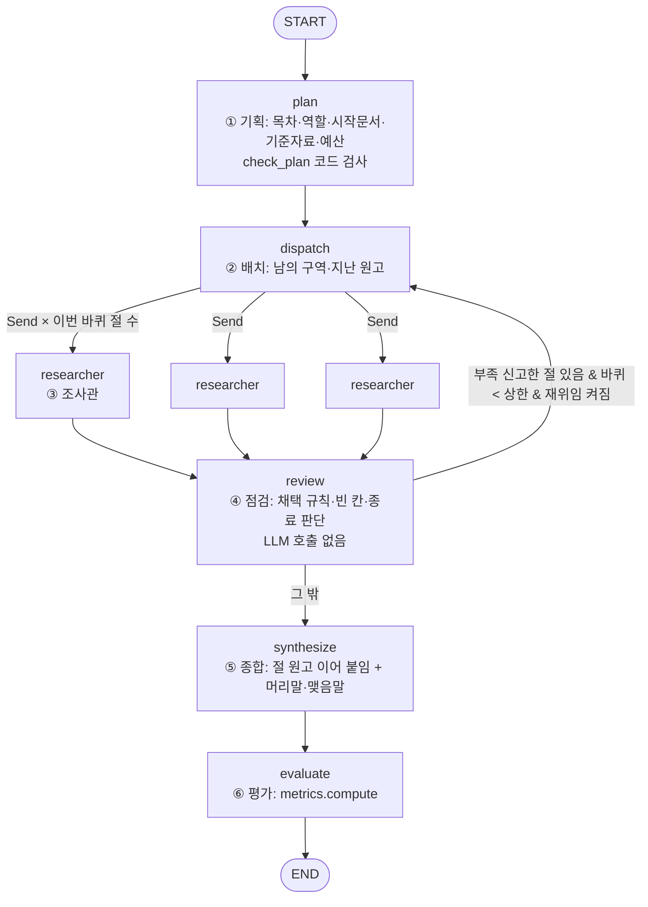
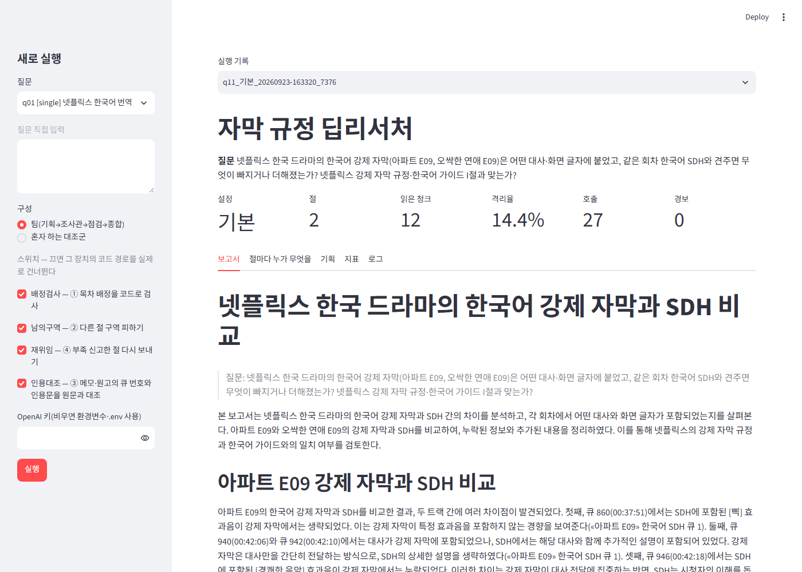
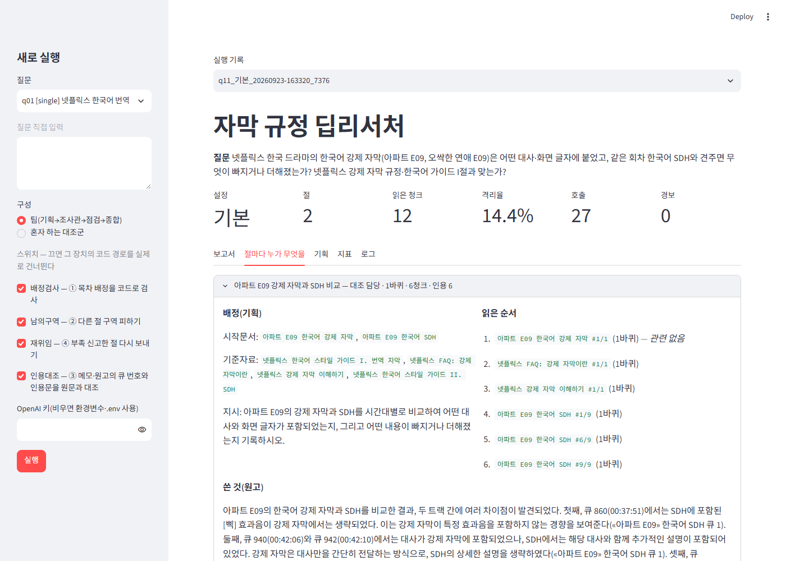

# REPORT — 자막 규정 딥리서처

- 과제: 모두의연구소 9강 프로젝트(오케스트레이터-워커 딥리서치 에이전트)
- 모델: gpt-4o-mini (코디네이터·조사관·대조군 모두)
- 프레임워크: LangGraph

## 1. 주제와 코퍼스

### 주제

- 스트리밍 자막의 **규정(스타일 가이드)과 실제 트랙이 맞는가**
- 이 주제를 고른 이유
  - 답이 문서 한 건에 없다: 규정은 영어 가이드에, 사례는 수만 자짜리 자막 트랙에 흩어져 있다
  - 트랙끼리 **같은 시간대**로 맞대야 보이는 것이 많다(강제 자막 ↔ SDH, 번역 ↔ 원문)
  - 작성자가 자막 도구를 만들며 모은 자료라 사례를 직접 검증할 수 있다

### 코퍼스 (`scripts/build_corpus.py`)

| 항목 | 값 |
|---|---|
| 문서 | 60건 = 규정 34 + 자막 트랙 26 |
| 규정 | 넷플릭스 파트너헬프 26건(한국어·영어 가이드는 절 단위로 나눠 30문서) + 디즈니+·쿠팡 작업자 자료 4건 |
| 트랙 | 넷플릭스 18 · 디즈니+ 7 · 쿠팡플레이 1 / 번역 12 · SDH·CC 10 · 강제 자막 3 · 원어 자막 1 |
| 글자 | 1,609,245자 |
| 토큰 | 836,287 (o200k_base) = gpt-4o-mini 창 128k의 **6.53배** |
| 링크 | 134 (규정 간 참조 + 트랙 → 종류에 맞는 규정 절 + 같은 회차 트랙끼리) |
| 링크 없는 문서 | 0 |

- 읽기 단위 = **청크**(8,000자 이하, 227개)
  - 트랙 하나가 최대 11.5만 자라 문서 단위로 읽으면 한 번에 창의 절반을 쓴다
  - 트랙은 큐 줄 경계, 규정은 `#` 제목 경계에서 자른다
- 뺀 것
  - 공개 규정이 없는 플랫폼(HBO·Viki·VIU)의 트랙 — 대조할 잣대가 없음
  - 강제 자막인지 확정 못 한 트랙, 컨테이너 손상 트랙(중국 드라마 3편)
- 저작권: 자막·규정 원문은 저장소에 없음. 로컬 원본에서 빌드
  - 대신 [data/corpus_index.json](data/corpus_index.json): 60건의 제목·메타·글자 수·토큰 수·청크 수와 links 전체(본문 제외, `scripts/export_index.py`)
  - 위 표의 숫자는 이 색인의 `합계`와 같다

### 질문 12건 (`data/questions.json`)

| 유형 | 문항 | 왜 이 유형인가 |
|---|---|---|
| 단일 | q01 한 줄 글자 수·읽기 속도 · q02 자막·SDH·CC 차이 | **일부러 넣음** — 규정 한 건이면 끝. 이 구조를 쓰면 안 되는 경우 |
| 흩어진 | q03~q06 · q11 · q12 | 플랫폼·작품·트랙이 여러 갈래. 갈래마다 한 명 |
| 한 대상 | q07~q10 | 한 작품·한 회차를 여러 언어 트랙으로 따라감. 원문 트랙은 모두가 기준으로 공유 |

- 정답표는 없다. 질문마다 `why`(나눌 만한가) 한 줄

## 2. 분업 설계

### 목차는 내용 단위로

- 절 = **자료(트랙·구간) 단위**. 작품별·플랫폼별·언어별
- 같은 자료를 역할만 바꿔 나누지 않는다
  - 읽기가 겹치고, "규정과 실제를 맞대기"를 아무도 안 하게 된다(종합은 원문을 못 본다)
  - 실측: q08에서 4절이 같은 트랙을 '규정·관행·대조·예외'로 나눠 가짐 → 코드가 합침(아래 기획 표 4·5회차)
- 형식 단위(개요·분석·결론) 금지는 프롬프트 + 코드 둘 다로 막는다

### 절마다 배정하는 것

| 칸 | 뜻 | 겹침 |
|---|---|---|
| 역할 | 명단 4개(규정·관행·대조·예외 담당) 중 하나 | - |
| 시작문서 | 그 절이 맡아 읽을 트랙(또는 청크 구간) | **금지** |
| 기준자료 | 대조할 규정 + 원문 쪽 트랙 | 허용(공유 잣대) |
| 예산 | 맡은 자료 4청크 + 규정 2청크 | - |
| 지시 | 무엇을 찾을지 한두 문장 | - |

- 역할 명단 (`config.json`)

| 역할 | 하는 일 |
|---|---|
| 규정 담당 | 해당 플랫폼·언어·자막 종류의 규정에서 기준 조항(수치·표기법·예외)을 찾아 조항 번호와 함께 뽑는다 |
| 관행 담당 | 실제 자막 트랙에서 표기 사례를 모으고 어떤 방식이 몇 번 쓰였는지 센다 |
| 대조 담당 | 같은 장면의 트랙 둘 이상을 시간대로 맞대어 무엇이 다르게 옮겨졌는지 적는다 |
| 예외 담당 | 규정과 어긋나거나 규정이 다루지 않는 사례를 찾아 어느 트랙 몇 번 큐인지 적는다 |

  - 역할은 절마다 하나. 역할만 바꿔 같은 자료를 나누는 것은 금지(아래 기획 표 4·5회차)
  - 실측(12문항 팀 74실행 · 185절): 대조 담당 149 · 관행 담당 18+5=23 · 규정 담당 12 · **예외 담당 1**
    - 트랙을 맞대는 질문이 대부분이라 '대조'로 쏠렸다. 규정 담당은 단일 질문(q01·q02)에서만 주로 뽑힘
    - 예외 담당 1회는 q09('규정에 맞는가'를 묻는 질문) — 쓰임새에 맞는 곳에서만 뽑혔다
    - 명단을 줄이지 않은 이유: 185절 중 1절만 바뀌어 효과가 시행마다의 흔들림에 묻히고, config가 바뀌면 기존 104실행과 비교할 수 없다

- 시작문서와 기준자료를 나눈 이유
  - 수업 코퍼스는 모든 문서가 내용이라 "겹침 금지" 하나로 충분했다
  - 여기서 규정·원문 트랙은 모두가 대는 잣대 → 겹침 금지를 적용하면 한 절만 규정을 갖고 나머지는 잣대 없이 출발(실측 q03)

### 배정을 코드가 검사한다 (`check_plan`, 스위치 `배정검사`)

- 모델은 그럴듯한 제목을 지어내고, 칸을 다른 용도로 쓴다. 코드는 **판단하지 않고** 사람이 만든 대응표(링크·필수 규정)만 조회한다
- 검사 순서(순서가 결과를 바꾼 전력이 있음)
  1. «»·따옴표 벗기기 → 없는 제목 제거
  2. 질문이 부르지 않은 트랙 제거
  3. 작품 이름 없는 질문 = 규정 질문 → 1절
  4. 같은 제목·규정만 받은 절 합치기
  5. 기준자료로 떠넘긴 번역 트랙 → 절로 올리기
  6. 시작문서 청크 겹침 제거(전부 겹치면 합침)
  7. 절 수 상한 초과분 → 가장 가벼운 절에 붙임
  8. 트랙 종류별 필수 규정·원문 트랙 채우기

### 기획 노드를 고친 순서 (실패 분석)

| 회차 | 증상 | 원인 | 고친 것 |
|---|---|---|---|
| 1 | q03: 한국어 가이드 II절을 1절이 가져가 나머지는 규정 없이 출발 | 규정까지 '겹침 금지' | 시작문서 / 기준자료 분리 |
| 2 | q01(단일)이 4절로 쪼개지고 SDH 트랙에 번역 절 규정 | 지시 과잉 교정 + 트랙 종류 무시 | 1절 조건 구체화, 기준 규정을 트랙 링크로 검사 |
| 3 | 모델이 제목에 «»를 붙여 전부 무효 | 카드 표기를 그대로 따라 씀 | `_clean`으로 괄호만 벗김 |
| 4 | q08: 같은 트랙을 역할만 바꿔 4절 | 형식 단위 분할의 변형 | 규정만 받은 절 해체, 같은 제목 합치기 |
| 5 | q08: 제목만 바꿔 같은 트랙 재배정 → 빈 절을 무관한 문서로 채움 | 제목 기준 합치기의 빈틈 | 합치기 기준을 **자료 겹침**으로 |
| 6 | q11: 5절 제안 → 1절로 뭉침 | 상한 처리가 겹침 검사보다 먼저 | 순서 교체 |
| 7 | q07: 원문 트랙 누락 | 원문을 담을 칸이 없음 | `기준자료`에 원문 쪽 트랙 허용 |
| 8 | q10: 번역 트랙 4개를 전부 기준자료로 넘기고 1절 | 공유 칸이 떠넘기기 통로 | 기준자료 트랙은 원문 쪽만, 번역은 절로 승격 |
| 9 | q04: 무관한 번역 트랙이 들어와 승격 규칙이 일감으로 만듦 | 질문 범위 검사가 작품 단위 | 트랙 단위 `asked_tracks` |

- 교훈: 모델에게 칸을 하나 열어 주면 그 칸을 다른 용도로 쓴다. 코드 규칙끼리도 부딪힌다 → 규칙을 바꿀 때마다 12문항 전체 재검사(`scripts/check_plans.py`)

### 컨텍스트 격리

- 원문은 `read_one()` 안에서만 쓰이고 밖으로는 메모만 나간다
- 위로 올라가는 것 = 절 원고 + 인용 + 자기신고(충분/부족 + 무엇이 비었나)
- 격리율 = 코디네이터가 본 글자 ÷ 조사관이 본 글자 — 실측은 8절 '격리를 숫자로'

## 3. 조사관 설계와 고친 것

### 한 조사관의 루프 (`researcher`)

1. 첫 시작 청크 읽기
2. **기준 예산**(2청크): 규정 청크만 후보로
3. 맡은 자료 예산(4청크): 모델이 후보에서 고름 — 코드가 후보 안인지 재검증
4. 메모만으로 절 원고 + 자기신고

- 후보(`frontier`)는 코드가 만든다
  - 짝 구간(작은 트랙의 큐 시각이 든 짝 트랙 청크) → 맡은 자료 다음 청크 → 같은 시간대 다른 트랙 → 기준 규정 → 링크 이웃
  - 남의 구역(다른 절 시작문서 + 다른 절이 이미 읽은 청크)은 뺀다(스위치 `남의구역`)
- **맞대기 보기**: 트랙 청크를 읽을 때 같은 회차 짝 트랙의 큐를 **시간이 겹치는 줄 바로 아래** 코드가 붙인다

```
[큐 860 | 00:37:51] - [삑] / - [영어] 해독 시작
    ↔ «아파트 E09 한국어 강제 자막» 큐 2 | 00:37:51: 해독 시작
```

### 조사관을 고친 순서 (실패 분석)

| 회차 | 증상 | 원인 | 고친 것 |
|---|---|---|---|
| 1 | q11: 3청크 중 2청크 '관련 없음', 규정을 한 줄도 안 읽고 '규정과 맞다' | 예산 하나를 트랙이 다 씀 | 기준 예산(규정 전용) 분리 |
| 2 | 규정을 뒤에 읽자 'SDH에 있고 강제 자막에 없는 것'을 전부 위반으로 적음 | 트랙을 읽는 동안 잣대가 없음 | 규정을 앞에(첫 청크 직후) |
| 3 | SDH 청크 메모에 '큐 1 00:06:14 태산' — 실제는 큐 113 | 탭 구분 줄에서 큐 번호를 잘못 읽음 | `[큐 N \| 시각]`으로 또렷이 렌더 |
| 4 | 강제 자막 '태산'이 SDH 큐 113에 있는데 '빠졌다' | 두 트랙을 따로 읽고 기억으로 맞춤 | 맞대기 보기(코드가 시간으로 정렬) |
| 5 | 강제 자막 37분·63분 큐를 SDH 앞 구간만 읽고 '없다' | 후보가 앞에서부터 순서대로 | 짝 구간 후보를 맨 앞에(이유 표시) + '안 읽은 구간은 확인하지 못했다고 적어라' |
| 6 | q10 영어 번역 6청크 전부 '관련 없음'인데 원고 534자(번역문까지 지어냄) | 메모 없이 집필 호출 | 관련 메모 0이면 집필하지 않고 부족 신고 |
| 7 | **규정 청크가 거의 전부 '관련 없음'** — «넷플릭스 강제 자막 이해하기»조차 3회 연속 | '관련 없으면 관련 없음' 지시가 **원문 앞**에 있으면 원문을 읽기 전에 답함 | 지시를 원문 **뒤**로 |
| 8 | 번역 절들이 «»를 안 씀(무근거절 4) | 남의 예시(아파트 E09)만 줌 | 예시에 그 절이 읽은 트랙 제목·큐를 넣음 |
| 9 | '관련 없음.'(마침표)을 관련 있음으로 셈 | 문자열 완전 일치 | `irrelevant()`로 정규화 |

- 7이 가장 컸다: 1~6을 고치는 동안에도 규정 메모가 비어 있었고, 지표(규정대조율)는 '규정 청크를 읽었다'만 봐서 못 잡았다. 사람이 메모를 펼쳐 보고 찾음
  - 실측: 같은 규정·같은 질문, 지시 위치만 다른 세 변형 → 앞: '관련 없음' / 뒤: 조항 추출 / 탈출구 없음: 조항 추출

## 4. 점검(재위임) 규칙

- LLM 호출 없음. 조사관 자기신고만 모은다
- 종료 조건 둘: 스위치 `재위임` 꺼짐 / 바퀴 상한(2) — 멈춘 이유를 `종료`에 남김
- 재위임 지시에 "지난번에 무엇을 읽었지만 무엇이 비었다"를 실어 겨냥
- 재위임 바퀴는 기준 예산 없음(규정은 1바퀴에 읽음), 지난 메모·읽은 청크에서 이어 읽음
- **두 번째 원고 채택 규칙**: 새 원고의 유효 인용 수가 지난 원고보다 적으면 지난 원고를 지킨다
  - 이유: 새로 읽은 메모까지 다 넣고 다시 썼는데 인용이 줄었다면 글이 나빠진 것
  - 무조건 덮어쓰면 인용 빠진 재작성본이 멀쩡한 원고를 지운다
  - 지킨 절은 `되돌림`에 남기고 로그에 찍는다

## 5. 지표 (`metrics.py`)

- 정답표·판정 모델 없음. 만들어진 글(원고·맺음말)과 실제로 읽은 청크만 본다
- **경보** = 0이어야 정상(하나라도 나오면 그 실행은 명백한 실패) / **견줌** = 설정끼리 비교할 때만 뜻이 있음

| 지표 | 종류 | 보는 장치 | 한 줄 설명 |
|---|---|---|---|
| 허위인용 | 경보 | ③ 조사관 · ⑤ 종합 | «»로 인용했는데 읽지도, 맞대기 보기로 보지도 않은 문서 수 |
| 범위밖큐 | 경보 | ③ 조사관 | '«트랙» 큐 N'의 N이 읽은 청크 범위에도, 본 짝 큐에도 없음 |
| 무근거절 | 경보 | ③ 조사관 | 유효 인용 0개인 절 수 |
| 무효배정 | 경보 | ① 배정검사 | 목차에 남은 없는 제목 수 |
| 격리율 | 견줌 | ②③ 격리 | 코디네이터 입력 글자 ÷ 조사관 입력 글자 |
| 중복률 | 견줌 | ② 남의구역 | 맡은 자료 읽기 중 다른 절도 읽은 청크 비율(기준자료 공유 읽기는 뺌) |
| 규정대조율 | 견줌 | ① 기준자료 · ③ | 트랙을 읽은 절 중 규정 청크도 읽은 절 비율 |
| 트랙도달률 | 견줌 | ① 기획 | 질문이 부른 트랙 중 누군가 읽은 비율 |
| 읽고안쓴문서 | 견줌 | ③ · ④ | 관련 메모가 나왔는데 원고에서 인용 안 한 문서 비율 |
| 인용밀도 | 견줌 | ③ | 원고 1,000자당 유효 인용 수 |
| 인용문일치율 | 견줌 | ③ | 큐 번호 하나 + 따옴표 인용이 있는 문장에서 인용문이 실제 그 큐 본문에 있는 비율 |
| 예산소진율 | 견줌 | 공정성 | 읽은 청크 ÷ 받은 예산 |
| 재위임절 · 재위임새청크 · 되돌림 | 견줌 | ④ 점검 | 루프가 실제로 돌았는지, 돌아서 새로 읽었는지, 재작성본을 버렸는지 |

- 버린 지표: '보고서 길이'(한 줄로 좋고 나쁨을 말할 수 없음), '관련 없음 비율'(지시 위치 하나로 뒤집힘 — 3절 조사관 표 7)
- 지표의 한계 (사람이 잡아야 하는 것)
  - 범위밖큐는 **번호가 범위 안이면 통과** — '«SDH» 큐 2'처럼 짝 트랙 번호를 엉뚱한 트랙에 붙여도 범위 안이면 못 잡음(q11 실측)
    - 그래서 **인용문일치율**을 나란히 읽기(8절) 뒤에 추가: 번호는 맞는데 내용이 다른 인용(q03 '큐 162 [음산한 음악]' ↔ 실제 '- 근데 / - [진경] 아!')을 잡음
    - 그래도 해석 오류는 못 잡음 — 인용문은 맞고 해석이 틀린 경우(큐 473 '와, 바람 소리야?'를 효과음이라 부름)
  - 규정대조율은 '규정 청크를 읽었다'만 봄 — 메모가 '관련 없음'이어도 100%(3절 조사관 표 7을 못 잡은 이유)

## 6. 파이프라인 구조도



| State 키 | 리듀서 | 내용 |
|---|---|---|
| `question` | - | 질문 |
| `plan` | 덮어쓰기 | 목차 · 배치(이번 바퀴 절 번호) · 바퀴 · 종료 사유 · 채택(절 번호 → 채택 원고) · 되돌림 · 재위임기록 · 예산기록 · 코드가 고친 것 |
| `sections` | `operator.add` | 조사관 원고(재위임되면 같은 절이 여러 벌 쌓임 → 점검이 바퀴로 거름) |
| `visited` | `operator.add` | (절 번호, 청크, 바퀴) — 누가 언제 무엇을 읽었나 |
| `task` · `prior` | - | `Send`로 조사관 한 명에게만 가는 지시 · 지난 원고 |
| `report` · `metrics` · `log` | 덮어쓰기 / add | 보고서 · 지표 · 노드별 로그 |

## 7. 코드 리뷰로 잡은 버그 (절제 실험 전)

- 첫 절제 실험을 돌리다 멈추고, 별도 리뷰 에이전트에게 "결과를 조용히 틀리게 만드는 버그"만 찾게 함 → 15건, 결과를 바꾸는 것 10건 고치고 처음부터 다시 돌림

| 버그 | 결과에 미친 영향 | 고친 것 |
|---|---|---|
| API가 계속 실패하면 `{}`를 돌려주고 계속 진행 | 빈 실행이 평균에 섞임(동시 6프로세스라 속도 제한 위험) | 일시적 오류가 다하면 예외, JSON 실패만 `{}` + 카운트 → 집계에서 뺌 |
| 재위임된 절의 피하기 목록에 **자기 시작문서 청크**가 들어감 | 남이 기준자료로 읽은 내 청크를 못 읽음 → 남의구역 비교가 기울어짐 | 피하기 = 남의 것 − 공유 − 내 것 |
| 빈 원고도 `충분=True` | 빈 절이 재위임에서 빠짐 | `충분 = (값이 True) and 원고 있음` |
| 후보를 25개로 자른 **뒤** 규정만 거름 | 트랙 청크가 많은 절(합친 절·대조군)은 기준 예산이 규정을 한 번도 못 봄 | 자르기 전에 거름(`rules_only`) |
| 지난 원고를 지킨 절은 다시 안 보내고 종료 사유도 틀림 | 바퀴 소진인데 '빈 칸 없음' | 빈 칸 = 이번 바퀴에 보낸 절 중 채택본이 부족한 절 |
| 배정검사를 끄면 «» 벗기기도 꺼짐 | 그 조건이 검사가 아니라 표기 잡음을 잼 | 형식 정리는 늘 켬 |
| 짝 트랙(맞대기 보기로 본 것) 인용을 허위로 셈 | 경보가 부풀려짐 | 본 짝 큐를 메모에 기록해 인정 |
| 팀은 절 원고만, 대조군은 보고서 전체 인용을 검사 | 검사 범위가 달라 비교 불공정 | 팀의 머리말·맺음말도 검사 |
| 대조군 보고서를 JSON 안에 받다가 깨짐 | 대조군 빈 보고서 | 대조군만 평문 마크다운 |
| 대조군 예산 = 팀이 **받은** 예산 | 팀이 일찍 멈추면 대조군이 더 읽음 | 팀이 **실제로 읽은** 청크 수의 평균 |

## 8. 절제 실험 결과

- 설정: 5문항(q01 단일 · q03 · q11 흩어진 · q07 · q10 한 대상) × 5설정(기본 · 스위치 셋 하나씩 끔 · 혼자 하는 대조군) × 3회 = 75실행
- 나머지 7문항은 기본 · 대조군만 2회씩 = 28실행(+ 빈 실행 대체 1) → 아래 '나머지 7문항'
- 호출 2,998회, 조사관 입력 약 2,037만 자(gpt-4o-mini)
- 대조군 예산 = 같은 문항 '기본'이 실제로 읽은 청크 수 평균 → 예산소진율 모든 설정 100%(공정성 확인)
- 전체 표: [output/ablation.md](output/ablation.md). 아래는 평균(최소~최대), n=3

### 한눈에

| 문항 | 설정 | 경보 난 실행 | 트랙도달률 | 인용밀도 | 인용문일치율 | 읽고안쓴문서 | 호출 |
|---|---|---|---|---|---|---|---|
| q03 | 기본 | 0/3 | 100 | 8.7 | 80.6 | 59.9 | 65 |
| q03 | 재위임끔 | **3/3** (허위 9 · 무근거 2) | 100 | **4.4** | 85.7 | 38.1 | 38 |
| q03 | 대조군 | 2/3 | **33.3** | 4.7 | - | 78.6 | 61 |
| q10 | 기본 | 0/3 | 80 | 6.2 | 63.0 | 33.3 | 53 |
| q10 | 배정검사끔 | 1/3 | **20** | 4.1 | 33.3 | 11.1 | **14** |
| q11 | 기본 | 1/3 (범위밖큐 3) | 100 | 8.5 | 94.4 | 14.3 | 32 |
| q11 | 대조군 | 2/3 | **50** | 4.5 | - | 54.2 | 31 |
| q01 | 기본 | 0/3 | - | 7.2 | - | 66.7 | 20 |
| q01 | 배정검사끔 | 0/3 | - | 8.0 | - | 26.9 | 38 (14~**77**) |

### 나머지 7문항 — 기본 vs 대조군 (n=2)

| 문항 | 성격 | 설정 | 경보 난 실행 | 트랙도달률 | 인용밀도 | 읽고안쓴문서 | 호출 |
|---|---|---|---|---|---|---|---|
| q02 | 단일 | 기본 / 대조군 | 0/2 · 0/2 | - | 6.2 / 4.0 | 25.0 / 33.3 | 14 / 13 |
| q04 | 흩어진 | 기본 / 대조군 | 0/2 · 1/2 (허위 4) | 60 / 40 | 9.7 / 4.4 | 16.6 / 68.8 | 43 / 41 |
| q05 | 흩어진 | 기본 / 대조군 | 0/2 · 1/2 (허위 1) | 44.4 / 33.3 | 5.2 / 8.9 | 0 / 50 | 50 / 49 |
| q06 | 흩어진 | 기본 / 대조군 | 0/2 · 0/2 | 50 / **0** | 8.0 / 5.1 | 37.0 / 68.2 | 43 / 41 |
| q08 | 한 대상 | 기본 / 대조군 | 1/2 (허위 1) · 0/2 | 66.7 / **0** | 7.5 / 3.4 | 26.8 / 72.2 | 31 / 29 |
| q09 | 한 대상 | 기본 / 대조군 | 0/2 · 0/2 | 100 / **0** | 6.5 / 6.2 | 33.3 / 65.0 | 40 / 37 |
| q12 | 흩어진 | 기본 / 대조군 | 0/2 · 2/2 (허위 6 · 무근거 1) | 62.5 / 75 | 7.3 / **1.1** | 22.5 / 75.0 | 31 / 29 |

- 대조군 예산 = 같은 문항 기본의 평균 읽기량(6~24청크), 예산소진율 모두 100%
- 5문항에서 본 경향이 그대로 나옴
  - 트랙도달률: 7문항 중 5문항에서 팀이 높음. q06·q08·q09 대조군은 **시작 자료로 규정만 골라 트랙을 한 청크도 안 읽음**(예산 전부를 규정 9~11건에 씀)
  - 읽고안쓴문서: 대조군 50~75% vs 팀 0~37% — 메모를 한 번에 쓰다 버리는 문제가 반복됨
  - 경보 난 실행: 팀 1/14 vs 대조군 4/14
- 예외: q12 대조군은 트랙도달률이 더 높지만(75 vs 62.5) 인용밀도 1.1 · 허위인용 6 — 트랙 이름은 대고 근거는 거의 안 붙인 글
- q02(단일): 14호출 vs 13호출, 1절 — q01처럼 나눌 이유 없음(질문의 `why`와 일치)
- n=2라 폭은 믿지 말 것(q09 기본 인용문일치율 0~100). 방향이 두 번 모두 같은 것만 위에 적음
- 빈 실행 1건: q05 대조군 1회가 1호출 · 0청크로 끝남 — 모델이 고른 시작 자료 제목이 전부 목록에 없어 버려졌고, 읽을 것 없이 빈 보고서를 씀
  - 고침: `baseline.pick_start`가 한 번 되묻고, 그래도 없으면 실행을 실패로 멈춤. `aggregate`는 읽은 청크 0인 실행을 평균에서 뺌(`_제외`에 남김) → 같은 예산으로 1회 다시 돌려 대체

### 장치별로 무엇이 값을 했나

- **배정검사** — 값을 함. 가장 크게
  - q10: 끄면 모델 목차가 1절(트랙 하나)로 뭉침 → 6청크만 읽고 트랙도달률 20%, 보고서 1/3 길이. 켜면 번역 트랙을 절로 올려 4절
  - q01(단일): 끄면 한 문서 질문을 여러 절로 쪼갬 → 최대 36청크·77호출, 중복률 최대 69%
  - 중복을 막은 것은 남의구역이 아니라 이 검사(시작문서 겹침 제거)
- **재위임** — q03에서만 값을 함
  - q03은 3회 모두 세 절이 전부 부족 신고 → 켜면 2바퀴에 4청크씩 더 읽고 다시 씀. 끄면 인용밀도 절반, 3회 모두 경보
  - q07·q10·q11은 재위임이 0~1절 — 첫 바퀴에 이미 맡은 트랙의 짝 구간을 봄(짝 구간 후보 덕). 비용만 조금
  - 채택 규칙이 실제로 작동: q03 기본 3회 모두 '지난 원고 지킴' 1건 — 재작성본이 인용을 잃은 절
- **남의구역** — 이 코퍼스에선 값을 못 함
  - 중복률 0%가 켜든 끄든 같음(배정검사를 끈 경우만 중복 발생)
  - 이유: 시작문서가 이미 겹치지 않고, 절마다 맡은 트랙이 예산(4청크)보다 길어(5~15청크) 남의 구역까지 갈 일이 없음
  - 수업 코퍼스(문서 34건, 링크로 퍼져 나감)와 다른 점. 트랙 하나가 긴 코퍼스에선 '구역'이 배정 단계에서 이미 정해진다
- **분업 자체(팀 vs 대조군)** — 흩어진 질문에서 값을 함
  - 같은 예산인데 대조군은 트랙도달률 33%(q03) · 50%(q11): 예산 절반을 규정 읽기에 씀(q11 대조군 3회 모두 규정 8청크 이상), 작품 하나만 다루고 나머지는 '확인하지 못했다'
  - 대조군은 관련 메모가 나온 문서의 54~79%(q03·q07·q11)를 보고서에서 한 번도 인용 안 함 — 메모 15~30개를 한 번에 쓰다 버림(q10만 37%)
  - 한 대상 질문(q07·q10)은 차이가 작음: 대조군도 원문 트랙 + 번역 트랙을 짝 구간으로 따라감(q07 트랙도달률 91.7로 오히려 높음)
  - 단일 질문 q01: 팀 20호출 vs 대조군 19호출, 보고서 비슷 → 나눌 이유 없음(질문의 `why`와 일치)

### 격리를 숫자로

- 코디네이터(기획·종합) 입력 글자와 조사관(읽기·고르기·집필) 입력 글자를 `ask()`가 따로 센다. 3회 평균

| 문항 | 기본 | 배정검사끔 | 남의구역끔 | 재위임끔 | 대조군 |
|---|---|---|---|---|---|
| q01 | 16.7% (1.5만 / 10.2만) | 15.6% (1.5만 / 20.3만) | 11.9% | 26.7% (1.5만 / 5.5만) | 100% |
| q03 | 4.7% (1.7만 / 36.1만) | 4.9% | 4.7% | 8.8% (1.7만 / 18.9만) | 100% |
| q07 | 4.5% (1.7만 / 39.4만) | 5.0% | 5.0% | 5.1% | 100% |
| q10 | 4.7% (1.7만 / 37.1만) | 23.5% (1.5만 / 6.3만) | 3.5% (1.7만 / 49.4만) | 4.9% | 100% |
| q11 | 10.1% (1.6만 / 16.3만) | 7.8% | 11.3% | 12.8% | 100% |

- 괄호 = 코디네이터 글자 / 조사관 글자
- 읽는 법
  - **코디네이터 입력은 어느 설정이든 1.5만~1.7만 자로 거의 고정**이다 — 카드 목록(약 1.3만 자) + 절 원고. 원문은 한 글자도 안 올라간다
  - 조사관 쪽은 절 수·바퀴에 따라 5만~49만 자. q10 기본 37.1만 자 ≈ 19만 토큰 — 팀 전체로는 창(12.8만 토큰)을 넘게 읽었는데 코디네이터는 그 5%만 봤다
  - 그래서 격리율이 높은 것은 격리가 깨져서가 아니라 **아래(분모)가 작아서**다: q01(1절)·재위임끔(덜 읽음)·q10 배정검사끔(6청크만 읽음)
  - 대조군은 위아래가 없으니 100%로 둔다 — 보고서를 쓰는 한 명이 읽은 것을 전부 봤다

### 흔들림

- 같은 설정·같은 문항에서도 크게 움직임: q10 기본 인용문일치율 25.0~88.9, q01 격리율 11.6~26.8
- 경보도 시행마다 다름: q11 기본은 3회 중 1회만 범위밖큐 3
- 그래서 차이가 3회 모두 같은 방향이고 폭이 흔들림보다 큰 것만 위에 적음(q03 재위임, q10 배정검사, q03·q11 트랙도달률)

### 과제가 경고한 흔한 사고 셋 — 어떻게 막았나

| 사고 | 이 프로젝트에서 막은 방법 |
|---|---|
| 지표가 좋아진 줄 알았는데 문장 분리 규칙이 바뀐 것 | 지표 코드를 바꾸면 **실험 실행 전부(현재 104)를 같은 코드로 다시 계산**한다(`ablation.py --collect --recompute`, API 호출 없음 — 저장소의 `runs.jsonl`도 함께 다시 씀). 인용문일치율의 따옴표 규칙을 두 번 고쳤을 때 모든 설정의 값이 함께 바뀌었다(q07 35→80→83%) — 설정 간 차이가 아니라 측정기가 바뀐 것이라 전 실행을 다시 셌다 |
| 스위치를 껐다고 로그만 찍고 실제 코드 경로는 그대로 | 스위치마다 꺼지면 건너뛰는 코드 경로가 다르다(배정검사 → `check_plan` 안 부름 / 남의구역 → 피하기 목록 비움 / 재위임 → 빈 칸 목록 비움). 없는 스위치 이름은 실행을 멈춘다(`apply_off`). 집계 때 각 실행의 저장된 config가 **정확히 그 조합**(끈 것만 False, 나머지 True)인지 assert한다. 리뷰 에이전트에게도 "로그만 바뀌는 스위치"를 따로 확인시켰다 |
| 한 번 돌린 결과로 단정 | 설정마다 3회. 표에 평균과 최소~최대를 같이 적고, 3회 모두 같은 방향이면서 폭이 흔들림보다 큰 차이만 결론으로 썼다. 흔들림 자체도 적었다(q10 인용문일치율 25~89%) |

## 9. 나란히 읽기와 실패 추적

### q11 — 기본 vs 대조군 (강제 자막 ↔ SDH)

- 읽은 것: `q11_기본_…_0172` / `q11_대조군_…_2128` 보고서 전문
- **기본이 낫다**, 이유
  - 두 작품을 다 다룸. 대조군은 아파트만 다루고 오싹한 연애는 '확인하지 못했다'
  - 인용 위치가 맞음: 기본이 든 큐를 원문과 대조 — 아파트 SDH 큐 860 '[삑] / [영어] 해독 시작', 862, 873, 878, 오싹한 연애 큐 327·426 모두 본문 일치
  - 대조군은 '«아파트 E09 한국어 SDH» 큐 1, 2'에 '태산'·'해독 시작'을 붙임 — 실제로는 강제 자막의 번호. SDH 큐 1은 '[주제곡]', 태산은 SDH 큐 113. 범위밖큐는 번호가 읽은 범위 안이라 못 잡음
- 대조군이 나은 대목: 아파트 해석은 대조군이 맞음('강제 자막 3개는 SDH에도 있고, SDH는 [삑]·[영어]를 더했다 → 규정 부합')
- **기본의 마음에 안 드는 대목**: "SDH의 '아, 무슨 첩보 영화 찍냐?'가 강제 자막에서 생략 → 규정 I절과 일치하지 않는다"
  - 강제 자막은 원래 일반 대사를 싣지 않는다 — 생략이 정상. 틀린 결론
  - 추적
    - 맺음말 ← 절 '아파트 E09 강제 자막과 SDH 비교'의 원고를 그대로 옮김(종합이 만든 오류 아님)
    - 절 원고 ← 메모 `아파트 E09 한국어 SDH #6/9`: "SDH에는 이 대사가 포함되어 있으나, 강제 자막에서는 생략됨"(사실만 적음, 판단 없음)
    - 규정 메모 `한국어 가이드 I #1/2`: I.8 원문을 정확히 옮김
    - → 오류는 **집필 단계**: 조사관이 사실 메모 + I.8을 이어 붙이며 '생략 = 위반'으로 해석
  - 더 근본 원인: 이 절은 기준 예산 2청크를 한국어 가이드 I 두 청크에 씀. 핵심 규정 «넷플릭스 강제 자막 이해하기»("모든 강제 자막 이벤트는 전체 자막·SDH 파일에도 들어가야 한다")를 안 읽음
- **둘 다 놓친 것**: 강제 자막 큐 3 '자막: 정옥림'(01:03:14)은 SDH에 짝 큐가 없음(±4초 안에 큐 0개, 직접 확인) — 위 규정대로면 실제 누락. 기본은 그 구간 청크(`SDH #9/9`)를 짝 구간 후보로 읽고도 메모에 적지 않음

### q03 — 기본 vs 재위임끔 (SDH 표기 규정)

- 읽은 것: `q03_기본_…_7184` / `q03_재위임끔_…_3772` 절 원고 셋씩
- **기본이 낫다**, 이유: 절마다 10청크(재위임 2바퀴) vs 6청크, 인용 7~13 vs 4~6, 재위임끔의 도라이버 절은 없는 규정 제목 3개를 인용(허위인용)
- 그러나 둘 다 **같은 큐를 반대로 판정**: 대체 등산 SDH 큐 473
  - 기본: "효과음이 대괄호 없이 표기" / 재위임끔: "효과음이 적절히 표기"
  - 원문: '와, 바람 소리야? 와, 진짜' — 효과음이 아니라 **대사**. 둘 다 틀림
- 달라달라 큐 14 '- [익살스러운 효과음] / - [제작진들의 웃음]'
  - 기본: "하이픈 없이 나열 → 위반" / 재위임끔: "대괄호 없이 표기" — 원문엔 하이픈도 대괄호도 있음. 둘 다 틀림
- 기본 도라이버 절 "큐 162 [음산한 음악]" — 실제 큐 162는 '- 근데 / - [진경] 아!' → 번호 틀림(인용문일치율이 잡는 유형)
- 추적: 세 건 모두 **메모는 원문을 그대로 옮겼다** → **집필 단계** 오류
  - 도라이버 메모 `SDH #2/8`: '큐 162 - 근데 / - [진경] 아!', 바로 다음 줄 '큐 163 [음산한 음악]' → 원고가 이웃 두 줄을 합쳐 '큐 162 [음산한 음악]'
  - 큐 473·큐 14도 메모엔 원문 그대로('와, 바람 소리야?' / '- [익살스러운 효과음] / - [제작진들의 웃음]') → 원고가 형식을 잘못 서술
  - 원인 추정: 집필 호출이 메모 8~10개(수십 줄)를 한 번에 받아 '표기 형식'이라는 세부를 옮기며 뭉갬. 맞대기 보기처럼 코드가 도와주는 장치가 집필 단계엔 없음
- 결론: 재위임은 '더 많이, 더 근거 있게'는 만들지만 **해석 정확도**는 바꾸지 못함. 지표가 좋아진 폭(인용밀도 2배)만큼 글이 맞아진 것은 아님

### 사람만 잡은 것 (지표가 놓친 것)

| 유형 | 사례 | 왜 지표가 놓쳤나 |
|---|---|---|
| 다른 트랙 번호를 붙임 | 대조군 '«SDH» 큐 1'에 태산 | 번호가 읽은 범위 안 |
| 인용은 맞고 해석이 틀림 | 큐 473 대사를 효과음으로 | 인용문이 실제 본문에 있음 |
| 규정 적용이 틀림 | 강제 자막의 대사 생략을 위반으로 | 규정 인용도, 트랙 인용도 유효 |
| 봐야 할 걸 안 봄 | 정옥림 FN의 SDH 누락 | '안 쓴 것'은 글에 흔적이 없음 |

## 10. 데모 설계

- streamlit, 로컬 실행: `streamlit run app.py`
- 화면
  - 위: 설정 · 절 수 · 읽은 청크 · 격리율 · 호출 · 경보(경보가 있으면 빨간 줄)
  - 탭 '절마다 누가 무엇을': 절마다 배정(시작문서·기준자료·지시) → 읽은 순서(바퀴, 관련 없음 표시) → 쓴 원고 → 허위인용·부족 신고 → 메모(로컬 전용)
  - 탭 '기획': 코드가 고친 것(없는 제목·합친 절·채운 규정…)과 목차 표
  - 탭 '지표': 값 + 종류(경보/견줌) + 보는 장치 + 뜻
- 새로 실행: 질문(12건 또는 직접 입력) · 팀/대조군 · 스위치 셋 · API 키(세션 안에서만)
- 설계 이유: 9절의 추적을 화면에서 그대로 할 수 있게 — '마음에 안 드는 문장 → 어느 절 → 어느 청크의 메모'를 클릭 두 번으로





## 11. 회고

### 가장 공들인 부분

- **가장 오래 걸린 건 구조가 아니라 읽기 한 번의 품질**
  - 그래프(기획·배치·점검·종합)는 수업 구조 그대로 하루 안에 돌았다
  - 시간은 '청크 하나를 읽고 맞는 메모를 내는가'에 들어감 — 지시 위치(원문 앞/뒤) 하나로 규정 메모가 전부 '관련 없음'이 됐다
- **코드가 맞대 주는 도구가 모델 지시보다 셌다**
  - '두 트랙을 시간으로 맞춰 보라'고 지시 → 실패. 맞대기 보기로 코드가 줄을 붙여 주자 강제 자막 ↔ SDH 대조가 맞기 시작
  - 반대로 q03은 메모까지 맞고 집필에서 틀림 — 코드 보조가 읽기 단계에만 있고 집필 단계엔 없다
- **스위치 셋 중 하나(남의구역)는 이 코퍼스에서 값을 못 했다** — 수업 코퍼스의 결론을 그대로 옮기지 않은 것이 맞았다
- **지표는 '명백한 실패 거르기'까지만**
  - 인용밀도는 재위임으로 2배가 됐지만, 나란히 읽으니 해석 오류는 그대로
  - 인용문일치율을 추가해 한 유형을 더 잡았지만, 해석·적용 오류와 '안 본 것'은 사람만 잡음
- **리뷰를 따로 돌린 게 실험을 살렸다**: 자기 피하기 목록, 빈 원고=충분, 규정이 잘려 나간 후보 — 셋 다 로그로는 멀쩡했다
### 보완하고 싶은 점

- 다음에 한다면
  - 기준 예산에서 규정을 모델이 고르게 두지 말고 트랙 종류별 핵심 조항(강제 자막 → '강제 자막 이해하기')을 먼저 읽게
  - 집필 단계 보조: 원고의 '큐 N + 인용문'을 코드가 원문과 대조해 틀린 문장만 다시 쓰게(인용문일치율을 지표에서 도구로)
  - 단일 트랙 절에 규칙 기반 표기 통계(대괄호·하이픈·화자 ID 개수)를 도구로 주기 — q03 오류 유형은 코드로 셀 수 있다
  - 상위 모델로 같은 절제 실험을 한 번 더 — 지표로는 못 잡고 원문 대조로만 찾은 오류(9절 표 — 틀린 해석·규정 적용 오류·다른 트랙 번호·놓친 누락)가 줄면 gpt-4o-mini의 한계, 그대로면 구조의 한계. 장치(배정검사·재위임)의 값이 줄어드는지도 함께 본다
